# Day 9: Azure Storage Accounts and Blob Containers: Architecture, Public Access Tiers, and Lifecycle Setup

*A comprehensive hands-on guide to provisioning General-Purpose v2 storage accounts, structuring blob directories, understanding Azure's dual-tier public access enforcement, and diagnosing PublicAccessNotPermitted errors.*

---

## Executive Summary and Learning Objectives

Cloud object storage is the foundational substrate for modern applications, hosting everything from unstructured media assets and static web applications to big data analytics datasets and backup archives. In Microsoft Azure, the core building block for object storage is the **Azure Storage Account**.

In this hands-on lab, we provision an enterprise-ready General-Purpose v2 (GPv2) storage account from scratch, configure container hierarchy with virtual directory prefixing, upload binary assets, and tackle Azure's strict multi-tier security boundaries. Specifically, we investigate why direct public access is blocked by default at the platform management plane, how the container-level and account-level authorization models interact, and how to safely enable anonymous read access for targeted workloads.

### Key Skills Acquired
- Deploying a scalable **StorageV2 (general-purpose v2)** account with Geo-Redundant Storage (GRS).
- Understanding storage account endpoints, naming conventions, and DNS resolution.
- Creating private blob containers and structuring logical virtual directories.
- Diagnosing the real-world **`PublicAccessNotPermitted`** XML error when accessing raw blob URLs.
- Decoupling Account-Level configuration (`Allow Blob anonymous access`) from Container-Level access policies (`Private` vs. `Blob` vs. `Container`).
- Verifying anonymous read operations directly via public HTTP/HTTPS endpoints.

---

## Architecture Overview

Azure Blob Storage is organized hierarchically into three distinct layers:

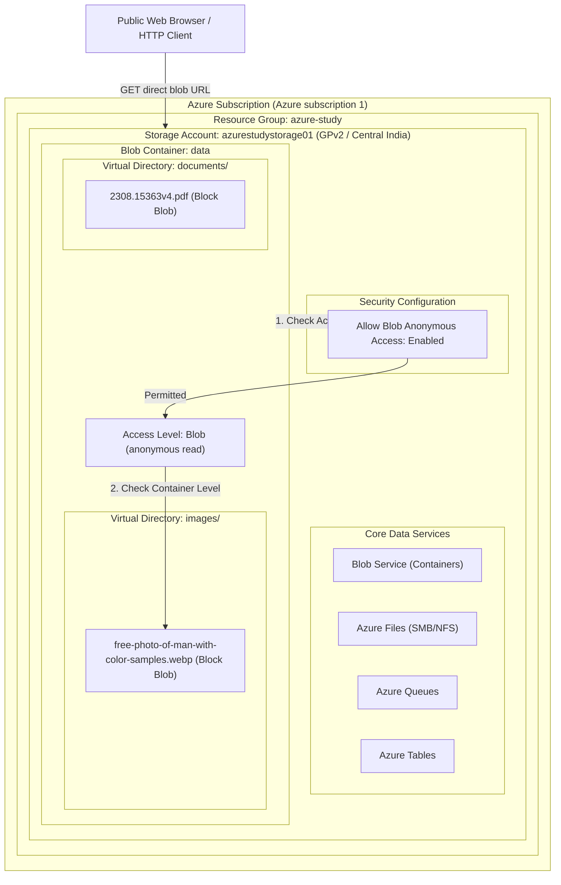

### Architectural Concepts:
1. **Storage Account:** A unique namespace in Azure for your data. Every object stored in Azure Storage has an address that includes your unique account name (e.g., `https://<accountname>.blob.core.windows.net`).
2. **Container:** A container organizes a set of blobs, similar to a directory in a file system. A storage account can include an unlimited number of containers.
3. **Blob:** A file of any type and size. Azure Storage supports Block Blobs (optimized for streaming and storing cloud objects), Append Blobs (optimized for append operations such as logging), and Page Blobs (optimized for random read/write operations, used for VM VHDs).
4. **Virtual Directories:** Blob storage uses a flat namespace. Slashes (`/`) in blob names create logical "virtual directories" that portal interfaces display like folders without filesystem overhead.

---

## Lab Specifications Table

| Parameter | Specification | Architectural Rationale |
| :--- | :--- | :--- |
| **Subscription** | Azure subscription 1 | Active billing and management scope |
| **Resource Group** | `azure-study` | Centralized resource lifecycle management |
| **Storage Account Name** | `azurestudystorage01` | Globally unique DNS prefix (3-24 lowercase alphanumeric characters) |
| **Region** | Central India | Regional compute and data residency compliance |
| **Account Kind** | StorageV2 (general-purpose v2) | Modern standard supporting Blobs, Files, Queues, Tables, and Data Lake Gen2 |
| **Performance Tier** | Standard | Cost-effective magnetic/SSD backing with high throughput |
| **Redundancy** | Geo-redundant storage (GRS) | Replicates data synchronously 3x in primary region, asynchronously 3x to secondary region |
| **Primary Service Focus** | Blob Storage | Unstructured object storage |
| **Container Name** | `data` | Base object repository |
| **Virtual Directories** | `images/`, `documents/` | Logical path partitioning |
| **Target Assets** | WEBP image, PDF document | Binary block blob validation |
| **Account Access Policy** | Allow Blob anonymous access = Enabled | Master gatekeeper for unauthenticated ingress |
| **Container Access Level** | Blob (anonymous read access for blobs only) | Grants anonymous GET requests to blobs while preventing container enumeration |

---

## Step-by-Step Implementation Guide

### Step 1: Navigating to Storage Accounts and Initial Configuration

From the Azure Portal search bar, type `Storage accounts` and navigate to the Storage Center blade.

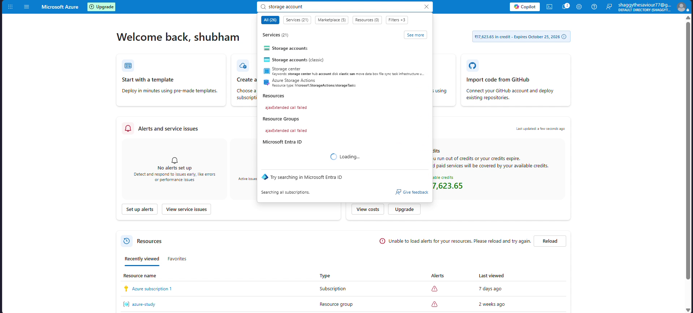

Click **Create** to launch the storage account deployment wizard:
- **Subscription:** Select `Azure subscription 1`.
- **Resource group:** Select `azure-study`.
- **Storage account name:** Enter `azurestudystorage01`. The name must be globally unique across all Azure accounts worldwide and conform strictly to lowercase letters and numbers.
- **Region:** Select `(Asia Pacific) Central India`.
- **Performance:** Select `Standard`.
- **Redundancy:** Select `Geo-redundant storage (GRS)` to safeguard against regional failure.

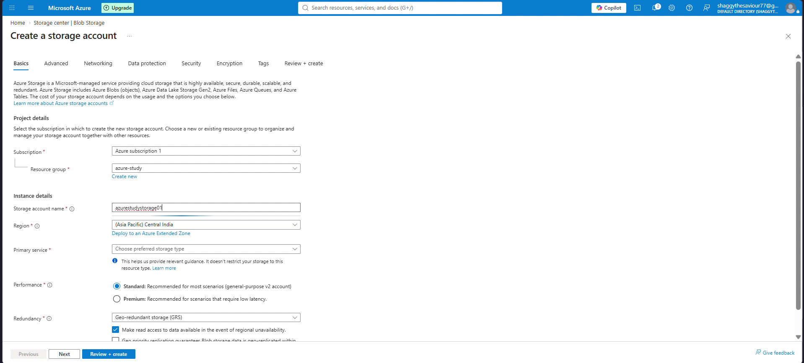

Click **Review + create**. Azure Resource Manager (ARM) runs validation against policies and resource quotas before initiating deployment.

---

### Step 2: Deployment and Resource Verification

Once validation passes, click **Create**. The ARM template engine allocates storage fabric clusters, registers regional endpoints, and creates the endpoint routes.

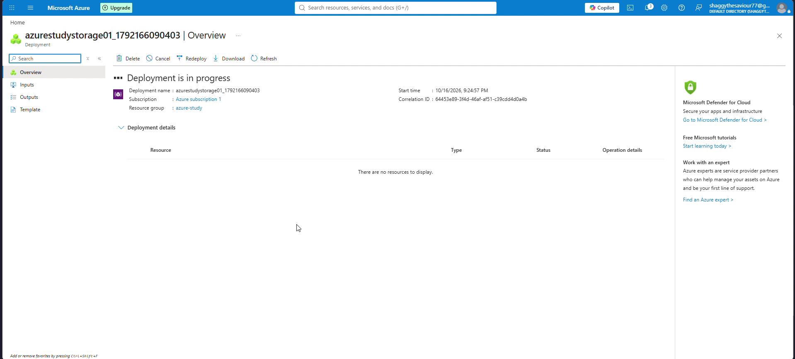

When deployment finishes, click **Go to resource** to open the overview dashboard of `azurestudystorage01`.

Under the **Data storage** section in the left navigation menu, select **Containers**. Notice that Azure automatically provisions the `$logs` container for operational telemetry.

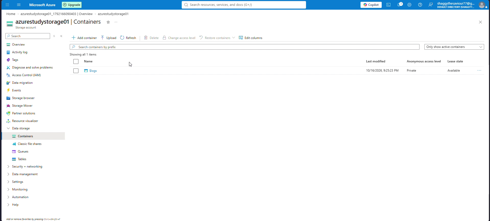

---

### Step 3: Creating the Container and Observing Default Protections

Click **+ Container** to create a storage container:
- **Name:** `data`
- **Anonymous access level:** Observe that the dropdown is locked to `Private (no anonymous access)`.

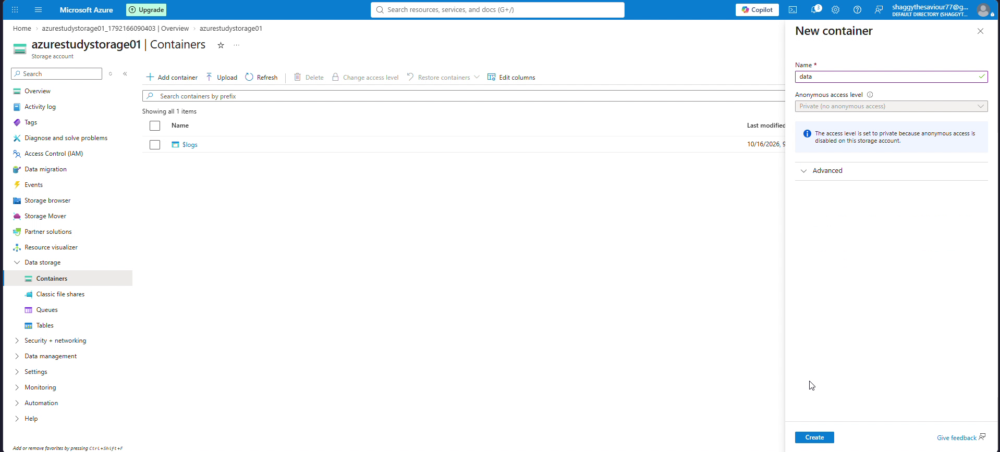

> [!IMPORTANT]
> Notice the informational callout: *"The access level is set to private because anonymous access is disabled on this storage account."*
> Azure applies Defense-in-Depth by default. Even if an administrator desires a public container, the account-level master switch prohibits anonymous access until explicitly overridden.

Click **Create** to initialize the private container.

---

### Step 4: Establishing Virtual Directories and Uploading Blobs

Open the newly created `data` container. Click **+ Add Directory** to define virtual folders for logical asset categorization:
- Directory name: `images`
- Directory name: `documents`

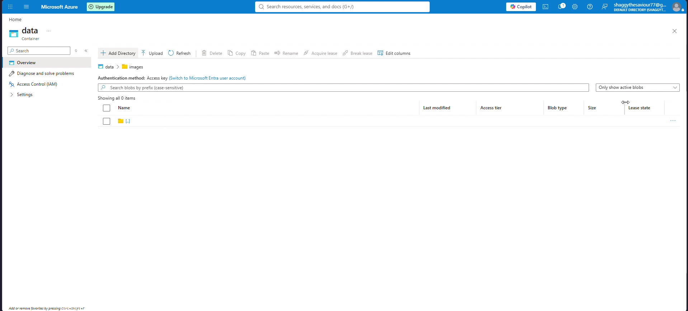

Navigate into the `images` virtual directory and click **Upload**:
1. Drag and drop `free-photo-of-man-with-color-samples.webp`.
2. Expand **Advanced** to inspect blob properties (Block Blob, Hot tier).
3. Click **Upload**.

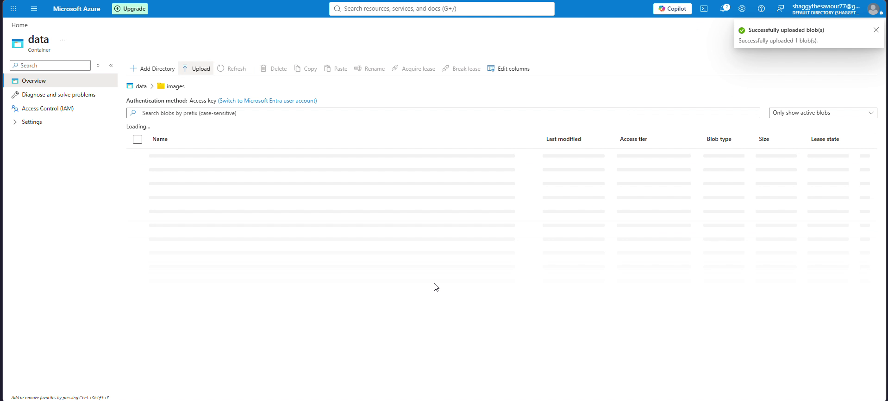

Repeat the operation in the `documents` folder by uploading a sample PDF document (`2308.15363v4.pdf`).

Click on the uploaded image blob to inspect its detailed metadata pane, including its immutable URL:
`https://azurestudystorage01.blob.core.windows.net/data/images/free-photo-of-man-with-color-samples.webp`

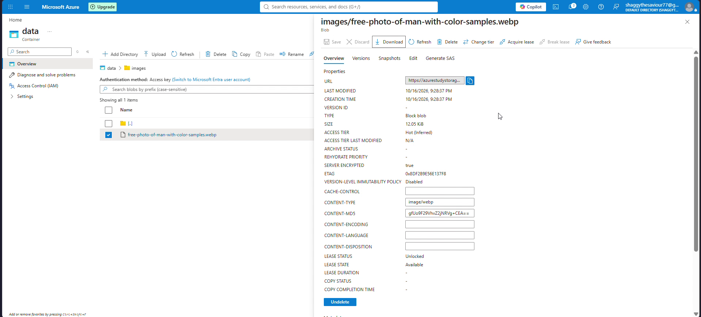

---

### Step 5: The Troubleshooting "Gotcha": Diagnosing PublicAccessNotPermitted

Copy the direct blob URL and paste it into a separate, unauthenticated browser window.

Instead of rendering the image, the browser returns an XML error response:

```xml
<Error>
  <Code>PublicAccessNotPermitted</Code>
  <Message>Public access is not permitted on this storage account. RequestId:be47d418-b01e-0012-7e87-5d2076000000 Time:2026-10-16T15:59:59.7665334Z</Message>
</Error>
```

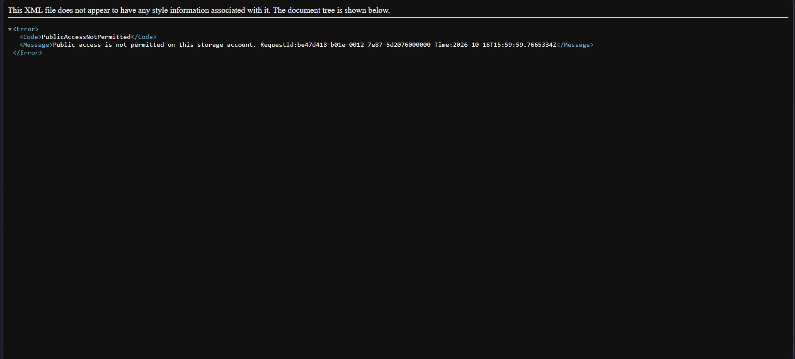

#### Architectural Root Cause Analysis
Since August 2023, Microsoft Azure enforces `allowBlobPublicAccess: false` as the platform-wide default for all newly created storage accounts. Even though you may want to serve public media, Azure enforces a **two-tier access gate**:

```
[Inbound HTTP Request]
         |
         v
+-------------------------------------------------------------+
| Tier 1: Storage Account Level Setting                       |
| Setting: "Allow Blob anonymous access"                      |
| If DISABLED -> Immediate 409 / PublicAccessNotPermitted     |
| If ENABLED  -> Proceed to Container Evaluation              |
+-------------------------------------------------------------+
         | (Only if Tier 1 is Enabled)
         v
+-------------------------------------------------------------+
| Tier 2: Container Level Access Policy                       |
| Options:                                                    |
|  - Private: Denies anonymous access                         |
|  - Blob: Permits anonymous GET/HEAD on individual blobs     |
|  - Container: Permits blob reads AND container listing      |
+-------------------------------------------------------------+
```

Because Tier 1 was disabled, our attempt to fetch the blob was rejected before container permissions were even evaluated.

---

### Step 6: Enabling Account-Level Anonymous Access

To resolve this issue:
1. In the storage account left-hand menu, scroll down to **Settings** and select **Configuration**.
2. Locate **Allow Blob anonymous access**.
3. Toggle the radio button from **Disabled** to **Enabled**.
4. Click **Save** at the top of the blade.

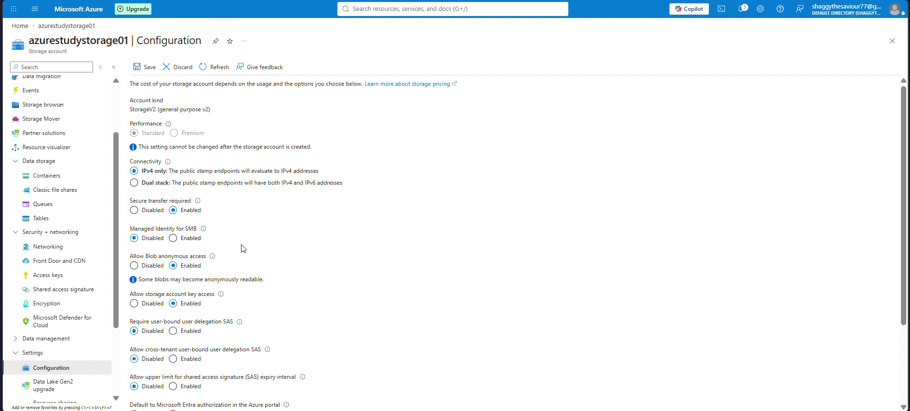

Azure updates the storage account management property `properties.allowBlobPublicAccess = true`.

---

### Step 7: Configuring Container Access Level and End-to-End Verification

With the account-level gate unlocked, return to **Data storage** -> **Containers**:
1. Select the `data` container.
2. In the top action bar, click **Change access level**.
3. Notice that the dropdown options are now fully selectable:
   - **Private (no anonymous access):** Default secure mode.
   - **Blob (anonymous read access for blobs only):** Allows external clients to view or download blobs if they possess the exact URL, but blocks them from listing container contents.
   - **Container (anonymous read access for containers and blobs):** Allows public users to enumerate all blobs and read objects.
4. Select **Blob (anonymous read access for blobs only)**.
5. Click **OK**.

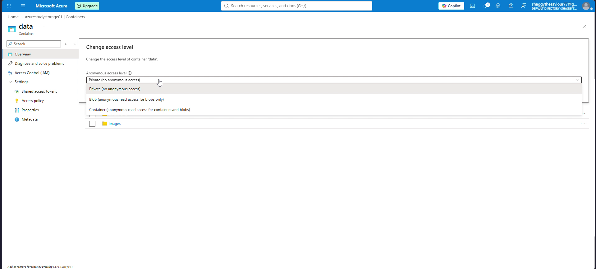

Now, switch back to the unauthenticated browser window and perform a hard refresh (`Ctrl + F5`) on the blob URL:

`https://azurestudystorage01.blob.core.windows.net/data/images/free-photo-of-man-with-color-samples.webp`

The image renders instantaneously without any tokens, credentials, or session cookies required!


---

## Azure CLI Reference Commands

For automated infrastructure-as-code deployments, execute the equivalent operations using Azure CLI:

```bash
# 1. Create a General-Purpose v2 Storage Account with GRS
az storage account create \
  --name azurestudystorage01 \
  --resource-group azure-study \
  --location centralindia \
  --sku Standard_GRS \
  --kind StorageV2

# 2. Query the current public access setting (returns false by default)
az storage account show \
  --name azurestudystorage01 \
  --resource-group azure-study \
  --query "allowBlobPublicAccess"

# 3. Enable Account-Level Anonymous Access
az storage account update \
  --name azurestudystorage01 \
  --resource-group azure-study \
  --allow-blob-public-access true

# 4. Create the blob container with public blob read access
az storage container create \
  --account-name azurestudystorage01 \
  --name data \
  --public-access blob \
  --auth-mode login

# 5. Upload a file into a virtual directory prefix
az storage blob upload \
  --account-name azurestudystorage01 \
  --container-name data \
  --name "images/free-photo-of-man-with-color-samples.webp" \
  --file "./sample.webp" \
  --auth-mode login
```

---

## Cost Optimization and Cleanup

Storage accounts accrue costs based on stored gigabytes per month, replication data transfer (GRS egress), and API transaction volume (read/write operations).

To prevent unintended billing when practicing in test environments:

### Portal Cleanup:
1. Open the `azure-study` Resource Group.
2. If only the storage account is being retired, select `azurestudystorage01` and click **Delete**.
3. Type the storage account name to confirm permanent removal.

### Azure CLI Teardown:
```bash
# Delete the specific storage account
az storage account delete \
  --name azurestudystorage01 \
  --resource-group azure-study \
  --yes

# Or delete the entire resource group if completing the lab cycle
az group delete --name azure-study --yes --no-wait
```

---

## Key Takeaways and Exam Tips (AZ-104)

- **Platform Security Defaults:** All new Azure storage accounts have anonymous access disabled at the account level (`allowBlobPublicAccess: false`). Enabling it requires explicit administrative intent.
- **Hierarchical Authorization:** Account-level configuration acts as a hard filter. If disabled at the account level, individual container settings are overridden and effectively ignored.
- **Blob vs. Container Access:**
  - `Blob access`: Anonymous clients can download blobs given the exact URL. Container enumeration is blocked. Ideal for web assets, documents, and public images.
  - `Container access`: Anonymous clients can discover and list all files in the container via Azure Storage REST API calls. Avoid using this in production unless building public open-source mirrors.
- **Virtual Directory Mechanics:** Directories in standard blob containers are client-side naming conventions created by delimiter slashes (`/`), not true hierarchical directories (unlike Azure Data Lake Storage Gen2 with Hierarchical Namespace enabled).
- **Redundancy Models:** GRS guarantees six copies across two paired regions (three in the primary zone via LRS, three asynchronously replicated to the secondary region).
