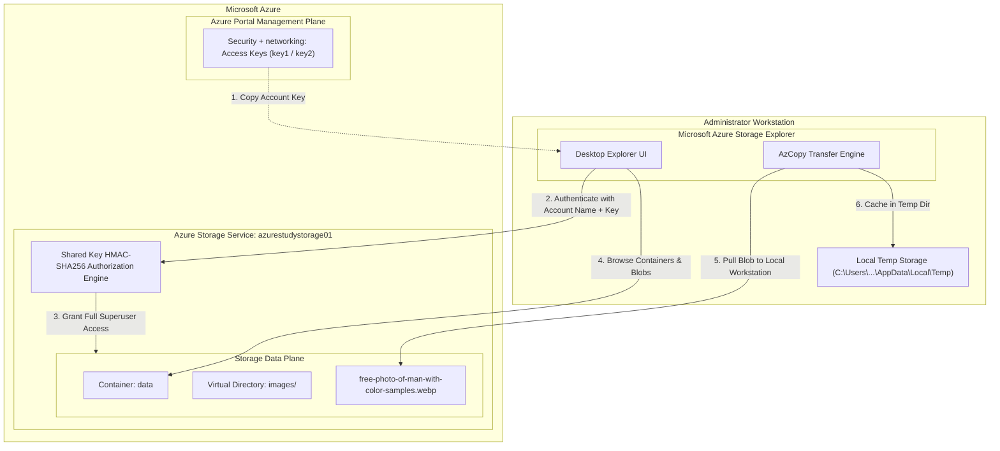
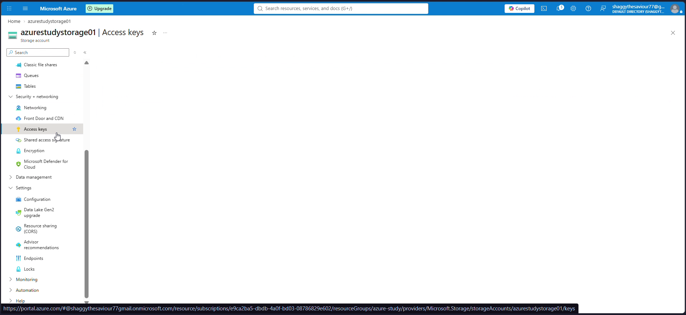
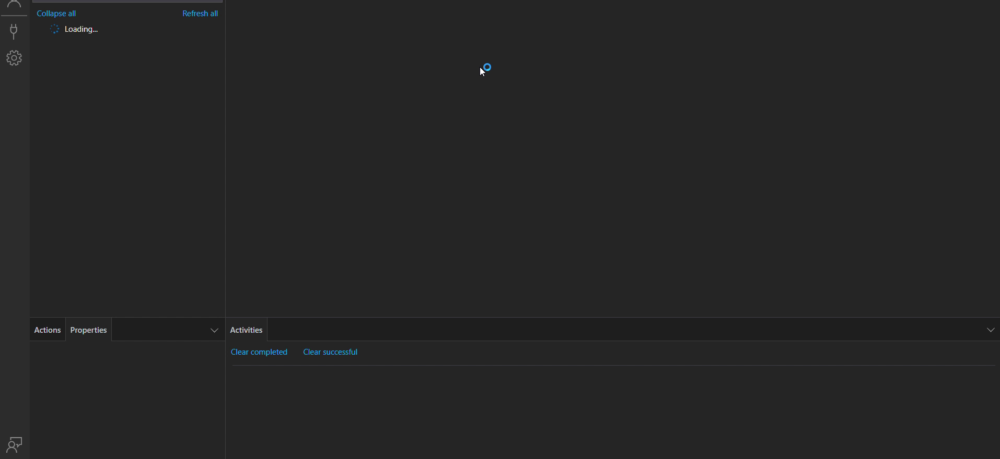
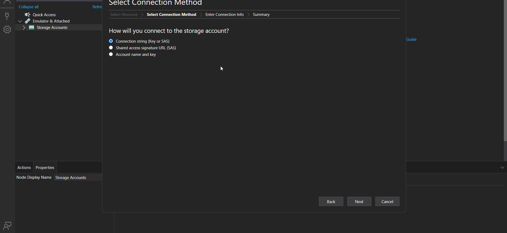
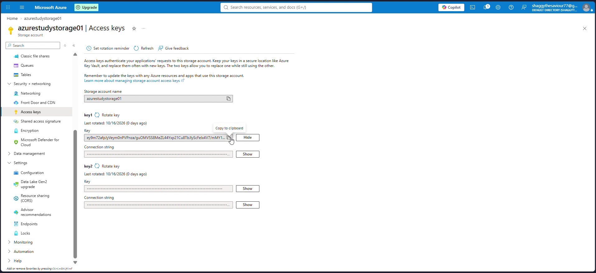
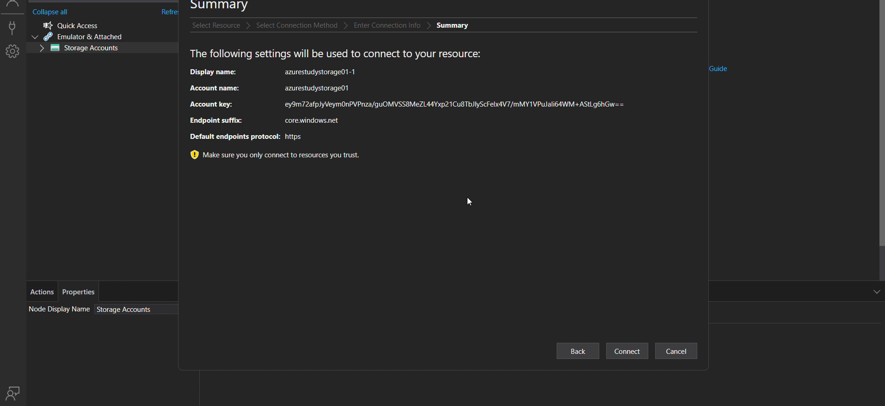
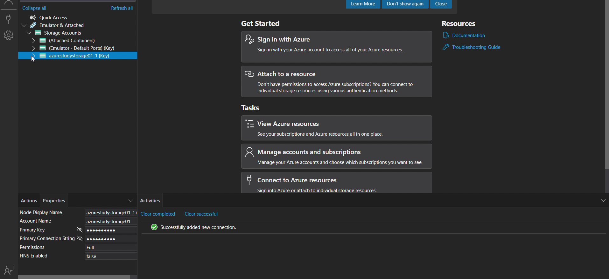
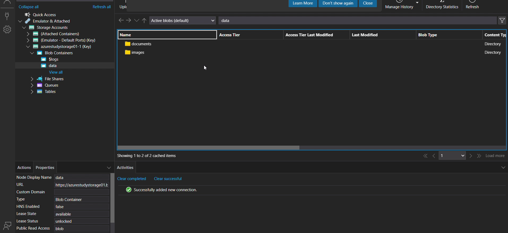
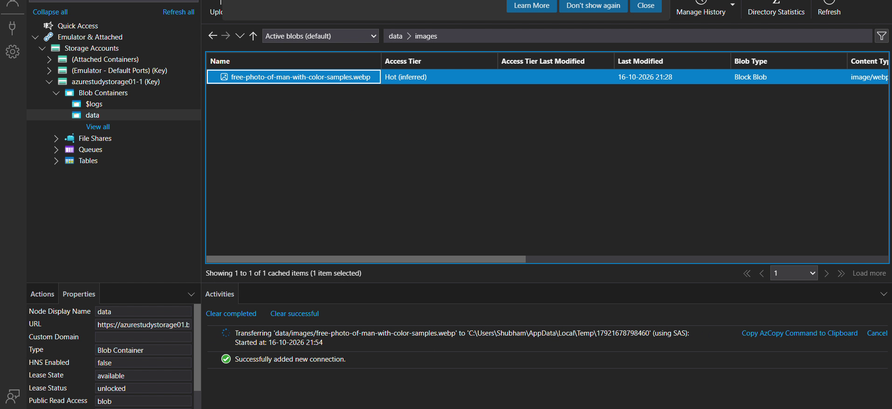
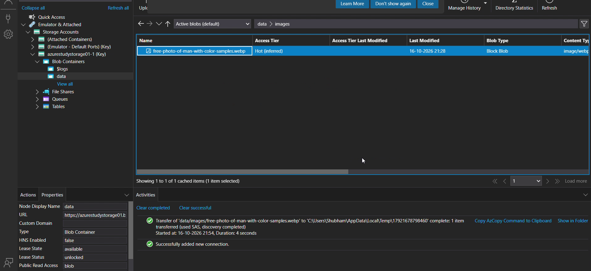

# Day 10: Azure Storage Explorer: Managing Storage Accounts with Access Keys

*A hands-on guide to authenticating desktop management tools using 512-bit storage account keys, browsing blob container hierarchies, and analyzing the security risks of shared root credentials.*

---

## Executive Summary and Learning Objectives

While the Azure Portal provides a web-based management interface for cloud assets, developers, DevOps engineers, and cloud architects frequently rely on desktop utility tools for high-throughput data operations, cross-platform synchronization, and local asset inspection. **Microsoft Azure Storage Explorer** is the industry-standard, standalone graphical application developed by Microsoft to manage blob containers, file shares, queues, tables, and Azure Data Lake Storage entities across Windows, macOS, and Linux.

In this hands-on lab, we connect Azure Storage Explorer to our existing cloud storage account using **Storage Account Access Keys**. We explore the mechanics of symmetric key authentication, inspect container hierarchies, download cloud objects to local environments using the integrated AzCopy data engine, and evaluate the security and governance implications of shared root keys versus role-based access models.

### Key Skills Acquired
- Extracting and managing primary and secondary storage access keys (`key1` and `key2`) from the Azure Portal.
- Connecting Azure Storage Explorer to remote cloud endpoints without requiring interactive Azure Entra ID tenant logins.
- Navigating hierarchical blob structures, container namespaces, and metadata properties.
- Performing local asset inspection and understanding background transfer mechanics powered by AzCopy.
- Analyzing the critical security implications and blast radius of storage account keys.
- Mastering the zero-downtime key rotation pattern required for enterprise compliance and AZ-104 certification.

---

## Architecture and Authentication Flow

When connecting to Azure Storage using an Account Key, the client generates a cryptographic Hash-Based Message Authentication Code (HMAC-SHA256) signature for every REST request:



### Architectural Principles:
1. **Shared Key Authorization:** Storage account keys are 512-bit symmetric encryption keys created when a storage account is initialized. Possession of either key grants unconditional, permanent superuser access across all four storage services (Blobs, Files, Queues, Tables) within the account.
2. **Dual-Key Model (`key1` and `key2`):** Azure provides two independent keys to enable zero-downtime credential rotation. Applications use one key while administrators regenerate the alternate key.
3. **AzCopy Under the Hood:** Azure Storage Explorer uses an embedded binary of AzCopy (a high-performance command-line utility) to stream files in parallel chunks, utilizing SAS tokens generated dynamically behind the scenes.

---

## Lab Specifications Table

| Parameter | Specification | Architectural Purpose |
| :--- | :--- | :--- |
| **Tool** | Microsoft Azure Storage Explorer | Standalone multi-platform cloud storage management client |
| **Storage Account** | `azurestudystorage01` | Target storage resource deployed on Day 9 |
| **Resource Group** | `azure-study` | Scope containing target storage account |
| **Authentication Method** | Account Name and Key | Direct symmetric key authentication |
| **Connection Display Name** | `azurestudystorage01-1` | Local alias within Storage Explorer connection tree |
| **Storage Domain** | Azure (`core.windows.net`) | Commercial public cloud endpoint suffix |
| **Default Protocol** | HTTPS | Encrypted TLS transport |
| **Permissions Level** | Full (Administrative) | Inherited by nature of shared access key authorization |
| **Target Container** | `data` | Base object repository |
| **Target Virtual Path** | `data/images/` | Logical directory prefix |
| **Inspected Asset** | `free-photo-of-man-with-color-samples.webp` | Block blob file transferred to local temp cache |

---

## Step-by-Step Implementation Guide

### Step 1: Navigating to Access Keys in the Azure Portal

To establish an authenticated connection from our desktop environment, we first retrieve the administrative access credentials:
1. Open the Azure Portal and navigate to the `azurestudystorage01` storage account overview blade.
2. In the left navigation menu under **Security + networking**, select **Access keys**.
3. Azure displays two pairs of credentials: `key1` and `key2`. Each key includes the raw base64 key string and a pre-formatted connection string.



> [!WARNING]
> Access keys bypass Azure Role-Based Access Control (RBAC). Anyone who obtains this key has full administrative rights to read, modify, and permanently destroy all data inside the storage account. Never commit these keys into source control repositories or share them in unencrypted communication channels.

---

### Step 2: Launching Azure Storage Explorer and Selecting Connection Method

Launch Microsoft Azure Storage Explorer on the local workstation. The main window displays the connection management pane and resource tree on the left:



Click the plug icon (**Open Connect Dialog**) or right-click **Storage Accounts** and choose **Connect to Azure Storage**:
1. Under **Select Resource**, choose **Storage account or service**.
2. Under **Select Connection Method**, choose **Account name and key**.



---

### Step 3: Entering Connection Credentials

In the **Enter Connection Info** step:
- **Display name:** Enter `azurestudystorage01-1` (a user-friendly label within the Explorer tree).
- **Account name:** Enter `azurestudystorage01`.
- **Account key:** Paste the base64 key copied from `key1` in the Azure Portal.
- **Storage domain:** Select `Azure (core.windows.net)`.
- Ensure the **Use HTTP** box remains unchecked to guarantee end-to-end HTTPS transmission.



Click **Next** to proceed to the summary screen.

---

### Step 4: Reviewing Connection Summary and Connecting

The **Summary** dialog displays the calculated endpoints and warns: *"Make sure you only connect to resources you trust."*



Click **Connect**. Storage Explorer validates the credentials by sending an authenticated request to the storage service. The activity log confirms:
`Successfully added new connection.`

In the left tree, under **Storage Accounts**, our new entity appears with the label:
`azurestudystorage01-1 (Key)`

Under the properties panel, observe:
- **Node Display Name:** `azurestudystorage01-1`
- **Account Name:** `azurestudystorage01`
- **Permissions:** `Full`



---

### Step 5: Browsing Containers and Virtual Folders

Expand `azurestudystorage01-1 (Key)`:
1. Notice that all four core services appear: **Blob Containers**, **File Shares**, **Queues**, and **Tables**.
2. Expand **Blob Containers** to reveal the `$logs` system container and our custom `data` container.
3. Select `data`, and navigate into the `images` virtual directory created during Day 9.



The main pane lists our uploaded blob:
- **Name:** `free-photo-of-man-with-color-samples.webp`
- **Access Tier:** `Hot (inferred)`
- **Blob Type:** `Block Blob`
- **Content Type:** `image/webp`



---

### Step 6: Transferring Assets to Local Storage and Local Inspection

Double-click on the image blob or select it and click **Download**:
1. Storage Explorer invokes its embedded **AzCopy** engine.
2. In the bottom **Activities** pane, the transfer process begins:
   `Transferring 'data/images/free-photo-of-man-with-color-samples.webp' to 'C:\Users\Shubham\AppData\Local\Temp\17921678798460' (using SAS)...`
3. Storage Explorer dynamically generates a temporary Shared Access Signature behind the scenes to authenticate AzCopy without exposing the primary key in plain text across local subprocesses.



Once download completes, Windows prompts with the application chooser (Photos, Chrome, Brave) to view the binary asset locally, confirming that data integrity was maintained across the entire cloud pipeline.


---

## Architectural Analysis: Security Risks and Best Practices

While Access Keys provide a rapid, hassle-free connection method for development environments, enterprise deployments must treat them with extreme caution.

### The Five Inherent Flaws of Storage Account Keys:
1. **Unscoped Authorization:** You cannot restrict an account key to read-only access, nor can you constrain it to a specific container, queue, or folder. It grants total superuser authority.
2. **No Expiration:** Unlike tokens, account keys are perpetual and never expire automatically.
3. **No Identity Audit Trail:** In Azure Monitor and Storage Analytics logs, operations signed with an account key show up simply as `SharedKey` authentication. There is no user identity, email, or service principal recorded.
4. **Vulnerable to Accidental Disclosure:** Developers frequently hardcode connection strings into application source code, configuration files, or build pipelines.
5. **Revocation Blast Radius:** Regenerating a compromised key invalidates that credential for every single microservice, server, and application utilizing it simultaneously.

### The Recommended Modern Enterprise Pattern:
For production workloads, Microsoft strongly recommends disabling Shared Key authorization entirely:
- **Azure Entra ID (RBAC):** Use roles such as `Storage Blob Data Contributor` or `Storage Blob Data Reader` mapped to user accounts or Managed Identities.
- **Disable Shared Key Access:** Set `allowSharedKeyAccess: false` on the storage account configuration to enforce Entra ID authentication and block all connection-string-based logins.

---

## Azure CLI Key Management and Zero-Downtime Rotation

To rotate compromised or expired access keys without causing application downtime, adhere strictly to the **Dual-Key Rotation Pattern**:

```
[Phase 1: Active]
  App uses: key1
  Standby:  key2

[Phase 2: Transition]
  1. Regenerate key2 (az storage account keys renew --key secondary)
  2. Update application configuration to point to newly generated key2
  3. Deploy / restart application (App now uses key2)

[Phase 3: Finalize]
  1. Verify application runs smoothly on key2
  2. Regenerate key1 (az storage account keys renew --key primary)
  3. Application remains online with zero downtime
```

### Automation Commands:

```bash
# 1. Retrieve the existing keys for the storage account
az storage account keys list \
  --account-name azurestudystorage01 \
  --resource-group azure-study \
  --output table

# 2. Regenerate the secondary key (key2)
az storage account keys renew \
  --account-name azurestudystorage01 \
  --resource-group azure-study \
  --key secondary

# 3. Regenerate the primary key (key1) after application updates
az storage account keys renew \
  --account-name azurestudystorage01 \
  --resource-group azure-study \
  --key primary

# 4. Enforce strict Entra ID authentication by disabling shared key access
az storage account update \
  --name azurestudystorage01 \
  --resource-group azure-study \
  --allow-shared-key-access false
```

---

## Cost Optimization and Cleanup

Connecting via Azure Storage Explorer generates minimal standard read transaction charges ($0.0004 per 10,000 read operations on Standard storage).

### Session Disconnection in Storage Explorer:
To keep your desktop tool clean and prevent accidental writes:
1. In Storage Explorer, locate `azurestudystorage01-1 (Key)`.
2. Right-click the node and select **Detach** (or **Remove**).
3. The connection is removed from your local profile; cloud assets remain intact.

---

## Key Takeaways and Exam Tips (AZ-104)

- **Root Access Nature:** A Storage Account Key provides complete access to all services and containers within that storage account, bypassing RBAC data plane controls.
- **Two Keys per Account:** Every Azure storage account has two 512-bit access keys (`key1` and `key2`) expressly designed to facilitate continuous, zero-downtime rotation.
- **Storage Explorer Utility:** Storage Explorer can connect via four methods:
  - Microsoft Entra ID (Azure account sign-in)
  - Connection string
  - Shared Access Signature (SAS) token or URL
  - Account name and key
- **AzCopy Engine:** Data transfers and local previews in Storage Explorer are performed under the hood using AzCopy, which converts high-level actions into multi-threaded chunked REST calls.
- **Modern Security Standard:** For AZ-104 exam questions regarding the most secure, auditable, and granular storage access model, the correct answer is always **Azure Entra ID with Azure RBAC (e.g., Storage Blob Data Contributor)**, not Access Keys.
