# Day 11: Azure Blob Storage: Shared Access Signatures (SAS) and Least Privilege Security

*A deep-dive hands-on guide to generating Service and Account SAS tokens, dissecting cryptographic URL parameters, enforcing granular CRUD permissions, and diagnosing authorization failures in desktop tools.*

---

## Executive Summary and Learning Objectives

In Day 10, we evaluated **Storage Account Access Keys** and established that while symmetric 512-bit keys provide immediate administrative connectivity, they represent an unacceptable security risk in production environments because they grant unrestricted, permanent superuser access across every service and container.

To adhere to the core security tenet of **Least Privilege (PoLP)**, Microsoft Azure provides **Shared Access Signatures (SAS)**. A SAS is a signed URI that grants delegated access to storage resources without exposing your account keys. It allows fine-grained control over what clients can access, what actions they can perform (Read, Write, Delete, List), which IP ranges can connect, and the exact window of time the signature remains valid.

In this practical lab, we explore the end-to-end security lifecycle of Shared Access Signatures. We generate both **Service SAS** and **Account SAS** tokens, dissect the underlying query string parameters, connect Microsoft Azure Storage Explorer using delegated credentials, and intentionally trigger authorization failures to demonstrate Azure's cryptographic access enforcement.

### Key Skills Acquired
- Generating resource-scoped **Service SAS** tokens for individual blobs and entire containers.
- Generating multi-service **Account SAS** tokens with explicit service (`ss=b`), resource type (`srt=sco`), and permission flags.
- Decoding and analyzing the seven critical cryptographic parameters within a SAS URL (`sp`, `st`, `se`, `spr`, `sv`, `sr`, `sig`).
- Diagnosing the common desktop client failure: *"The SAS has inadequate permissions. A service SAS with at least List permission ('sp=l') is required."*
- Proving authorization enforcement when an unprivileged SAS attempts deletion (`Failed to start delete: Insufficient credentials`).
- Establishing an elevated Account SAS connection to successfully execute lifecycle object deletion.

---

## Architecture and SAS Token Mechanics

A Shared Access Signature appends cryptographic query parameters to an Azure Storage REST endpoint. Azure Storage verifies the signature using HMAC-SHA256 without contacting external identity servers:

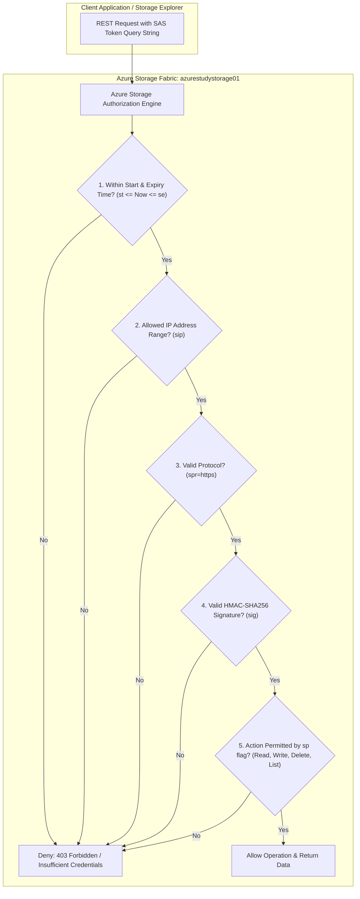

### The Three Types of Shared Access Signatures:

| SAS Type | Scope & Resource | Signed By | Revocation Mechanism |
| :--- | :--- | :--- | :--- |
| **User Delegation SAS** | Blob storage only (Containers & Blobs) | Microsoft Entra ID credentials | Revoke OAuth token or change Entra ID role assignment |
| **Service SAS** | Specific resource (single Blob, File share, Queue, or Table) | Storage Account Key (`key1` or `key2`) | Stored Access Policy (SAP) or rotating the signing account key |
| **Account SAS** | Multi-service across one or more storage services (`Blob`, `File`, `Queue`, `Table`) | Storage Account Key (`key1` or `key2`) | Rotating the signing account key |

---

## Dissecting the SAS URL Cryptographic Parameters

When Azure generates a SAS URL, it appends a structured query string:

`https://azurestudystorage01.blob.core.windows.net/data/images/free-photo-of-man-with-color-samples.webp?sp=r&st=2026-10-16T16:36:13Z&se=2026-10-17T00:51:13Z&spr=https&sv=2026-02-06&sr=b&sig=...`

| Parameter | Meaning | Example Value | Function |
| :--- | :--- | :--- | :--- |
| `sp` | **Signed Permissions** | `r`, `rl`, `rdl` | Specifies allowed operations: `r` (read), `w` (write), `d` (delete), `l` (list), `a` (add), `c` (create). |
| `st` | **Signed Start Time** | `2026-10-16T16:36:13Z` | UTC timestamp before which the SAS is inactive. |
| `se` | **Signed Expiry Time** | `2026-10-17T00:51:13Z` | UTC timestamp after which the SAS is permanently rejected. |
| `spr` | **Signed Protocol** | `https` | Enforces TLS transport security. Rejects unencrypted HTTP calls. |
| `sv` | **Signed Version** | `2026-02-06` | Storage service REST API version used to construct the signature. |
| `sr` | **Signed Resource** | `b` (blob), `c` (container) | Target resource scope for a Service SAS. |
| `ss` | **Signed Services** *(Account SAS)* | `b` (blob), `f` (file), `q`, `t` | Target services authorized by an Account SAS. |
| `srt` | **Signed Resource Types** *(Account SAS)* | `s` (service), `c` (container), `o` (object) | Level of storage fabric hierarchy unlocked. |
| `sig` | **Signature** | `DfsVrrd8sZaUtOz...%3D` | Cryptographic HMAC-SHA256 hash computed using the account key over the canonicalized fields. |

---

## Lab Specifications Table

| Parameter | Specification | Purpose |
| :--- | :--- | :--- |
| **Storage Account** | `azurestudystorage01` | Cloud storage resource |
| **Resource Group** | `azure-study` | Resource lifecycle container |
| **Service SAS #1 Scope** | Blob (`data/images/free-photo-of-man-with-color-samples.webp`) | Fine-grained object read validation |
| **Service SAS #1 Permissions** | `Read` (`sp=r`) | Minimal read permission |
| **Service SAS #2 Scope** | Container (`data`) | Container-level access validation |
| **Service SAS #2 Initial Permissions** | `Read` (`sp=r`) | Triggers the desktop client enumeration gotcha |
| **Service SAS #2 Adjusted Permissions**| `Read`, `List` (`sp=rl`) | Grants container attachment and traversal |
| **Account SAS Scope** | Account-wide (`azurestudystorage01`) | Elevated administrative lifecycle management |
| **Account SAS Permissions** | `Read`, `Delete`, `List` (`sp=rdl`) | Unlocks blob deletion while omitting write/create |
| **Target Binary Asset** | `free-photo-of-man-with-color-samples.webp` | Deleted under strict SAS governance |

---

## Step-by-Step Implementation Guide

### Step 1: Generating a Blob-Level Service SAS with Read-Only Rights

Navigate to the `azurestudystorage01` storage account in the Azure Portal:
1. Open **Data storage** -> **Containers** -> `data` -> `images`.
2. Click on `free-photo-of-man-with-color-samples.webp`.
3. In the right-hand panel, select the **Generate SAS** tab.
4. Configure the parameters:
   - **Signing method:** Account key
   - **Signing key:** Key 1
   - **Permissions:** Check **Read** only.
   - **Start and expiry date/time:** Set validity for 8 hours.
   - **Allowed protocols:** `HTTPS only`.
5. Click **Generate SAS token and URL**.
6. Copy the resulting **Blob SAS URL**.

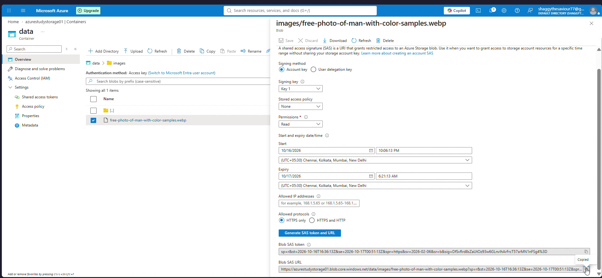

This URL can be distributed to external web clients. Recipients can download this exact image file, but cannot discover other blobs in the folder or overwrite the asset.

---

### Step 2: Generating a Container-Level Service SAS

To grant access to an entire container rather than a single file:
1. Navigate back to the `data` container overview.
2. In the left navigation menu under **Settings**, select **Shared access tokens**.
3. Configure the container SAS:
   - **Signing method:** Account key (`Key 1`)
   - **Permissions:** Select **Read** only.
   - **Start and expiry date/time:** 8-hour window.
   - **Allowed protocols:** `HTTPS only`.
4. Click **Generate SAS token and URL**.
5. Copy the generated **Blob SAS URL**:
   `https://azurestudystorage01.blob.core.windows.net/data?sp=r&st=...&sr=c&sig=...`

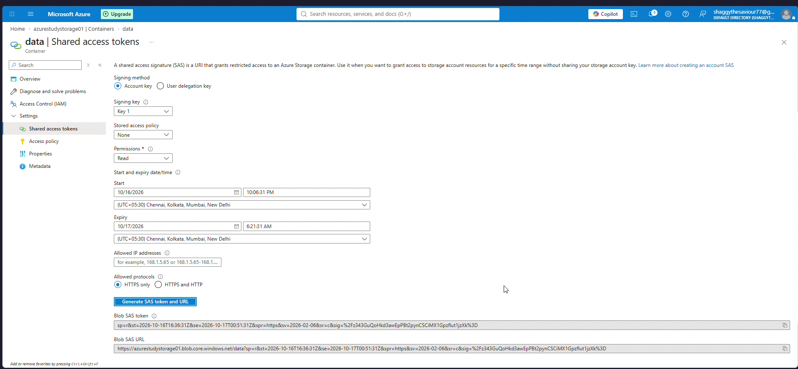

---

### Step 3: The Troubleshooting "Gotcha" #1: Storage Explorer Rejection

Open Microsoft Azure Storage Explorer:
1. Open the Connect dialog -> **Blob container or directory** -> **Shared access signature URL (SAS)**.
2. Enter Display name: `data-1`.
3. Paste the Container SAS URL.
4. Immediately, Storage Explorer blocks connection with a red validation error:

```
The SAS has inadequate permissions. A service SAS with at least List permission ('sp=l') is required.
```

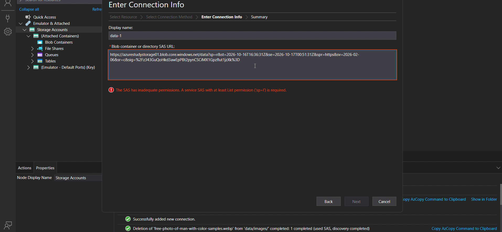

#### Architectural Root Cause:
Azure Storage distinguishes between **reading data** (`Get Blob`, requires `Read` / `r`) and **enumerating metadata** (`List Blobs`, requires `List` / `l`). A headless application with hardcoded blob URLs functions perfectly with only `Read` permissions. However, a graphical user interface (like Storage Explorer or the Azure Portal) must issue a `List Blobs` REST call to render the folder structure. Because our SAS omitted the `l` flag, Storage Explorer prevented connection.

---

### Step 4: Adding List Permission to the Container SAS

Return to the Azure Portal on the container's **Shared access tokens** blade:
1. Open the **Permissions** dropdown.
2. Check both **Read** and **List**.
3. Click **Generate SAS token and URL**.
4. Notice that the query parameter updates from `sp=r` to `sp=rl`.

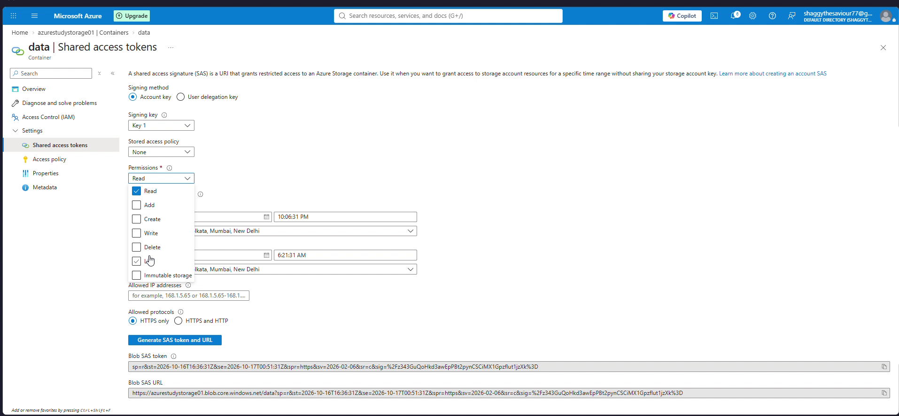

Return to Storage Explorer, paste the updated SAS URL, and click **Next** -> **Connect**.

The container attaches successfully as `data-1 (SAS)` under **(Attached Containers)**. We can now expand virtual directories and view all objects!

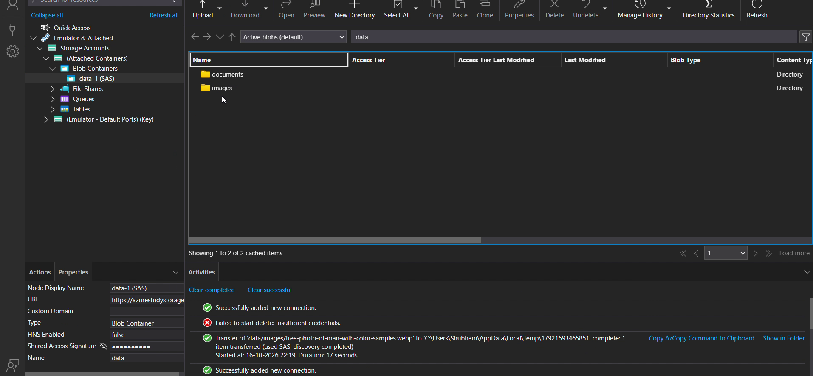

---

### Step 5: The Troubleshooting "Gotcha" #2: Delete Rejected by Authorization Policy

Inside Storage Explorer under `data-1 (SAS)`, navigate to `images`:
1. Select `free-photo-of-man-with-color-samples.webp`.
2. Click **Delete** in the top action bar or context menu.
3. Observe the bottom **Activities** log. The delete operation fails immediately with a red circle indicator:

```
Failed to start delete: Insufficient credentials.
```

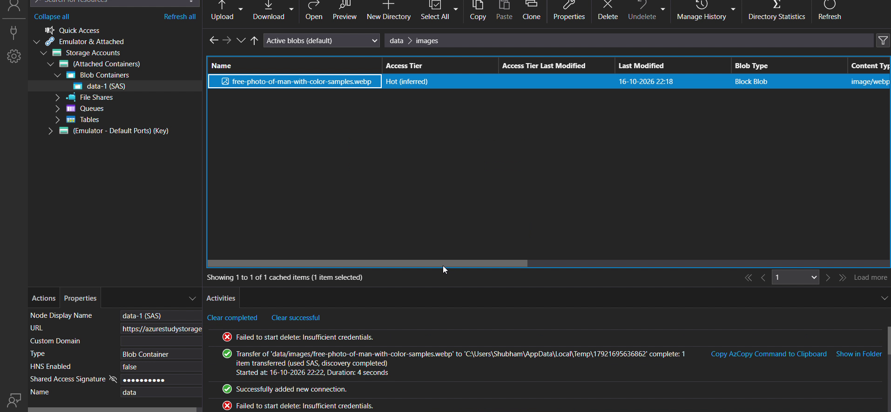

#### Architectural Root Cause:
Our Container SAS possesses only `sp=rl` (Read and List). When AzCopy dispatches the `DELETE` HTTP request to the REST endpoint, the Azure Storage authorization engine computes the HMAC signature, parses the `sp` query flag, detects the absence of the `d` (Delete) permission, and returns an HTTP `403 Forbidden` response.

This demonstrates the **Principle of Least Privilege in action**: users provided with read/browse access cannot delete or alter organizational data, even if using powerful desktop tools.

---

### Step 6: Escalating Privileges Safely via an Account SAS

To authorize deletion without exposing root storage account keys, we configure an **Account SAS**:
1. In the Azure Portal, navigate up to the `azurestudystorage01` storage account overview.
2. Under **Security + networking**, select **Shared access signature**.
3. Configure the Account SAS:
   - **Allowed services:** Check **Blob** only (omitting File, Queue, Table).
   - **Allowed resource types:** Check **Service**, **Container**, and **Object** (`ss=b`, `srt=sco`).
   - **Allowed permissions:** Select **Read**, **Delete**, and **List** (omitting Write, Add, Create).
   - **Start and expiry date/time:** 8-hour window.
   - **Allowed protocols:** `HTTPS only`.
   - **Signing key:** `key1`.

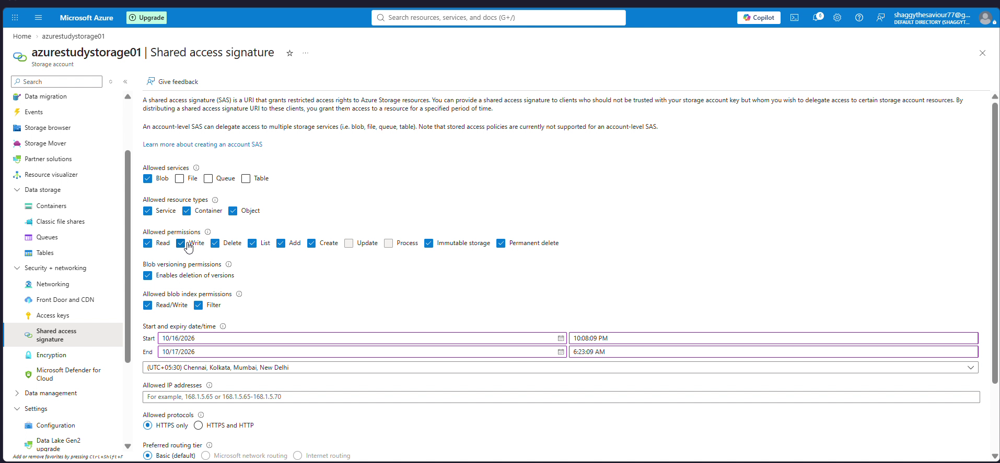
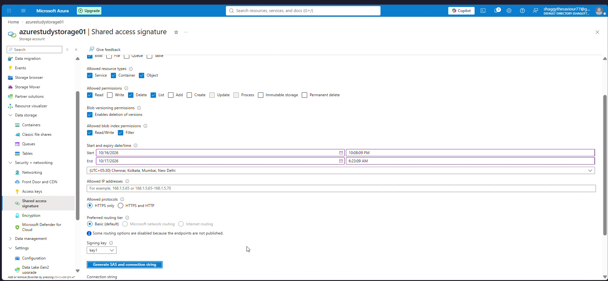

Click **Generate SAS and connection string**. Copy the **Connection string** or **SAS token**.

---

### Step 7: Connecting with Account SAS and Completing Deletion

In Azure Storage Explorer:
1. Open the Connect dialog -> **Storage account or service** -> **Shared access signature URL (SAS)**.
2. Enter Display name: `azurestudystorage01-1 (SAS)`.
3. Paste the Service URL with the Account SAS query string.

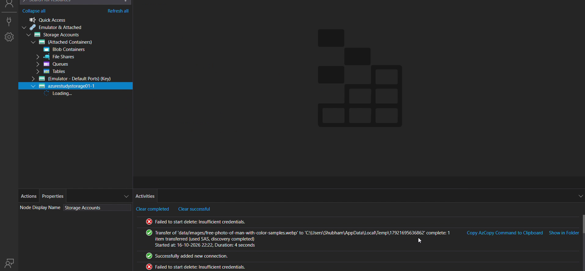

Click **Next** -> **Connect**. The storage account attaches as `azurestudystorage01-1 (SAS)`.

Navigate to `data/images`:
1. Select `free-photo-of-man-with-color-samples.webp`.
2. Notice the blob details and active SAS authorization.

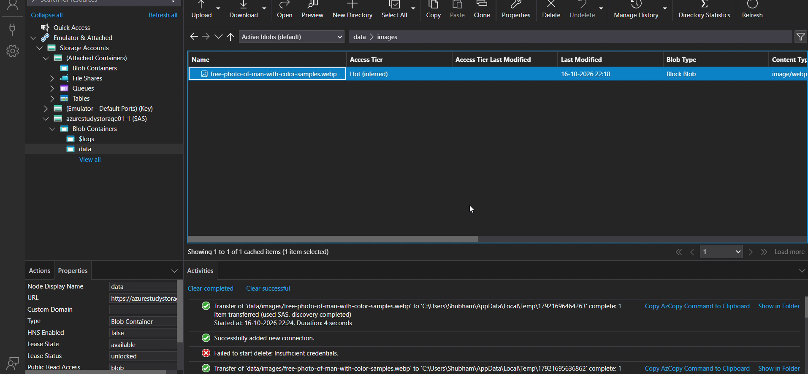

Right-click the image blob and select **Delete**:

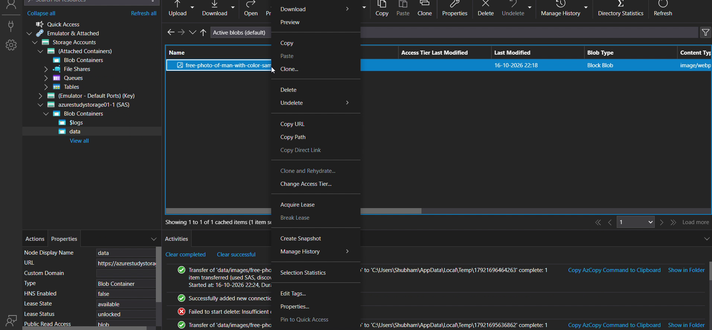

Storage Explorer executes the deletion via AzCopy. In the Activities pane:

```
Deletion of 'free-photo-of-man-with-color-samples.webp' from 'data/images/' completed: 1 completed (used SAS, discovery completed)
```

The container refreshes and shows: *"No data available."*

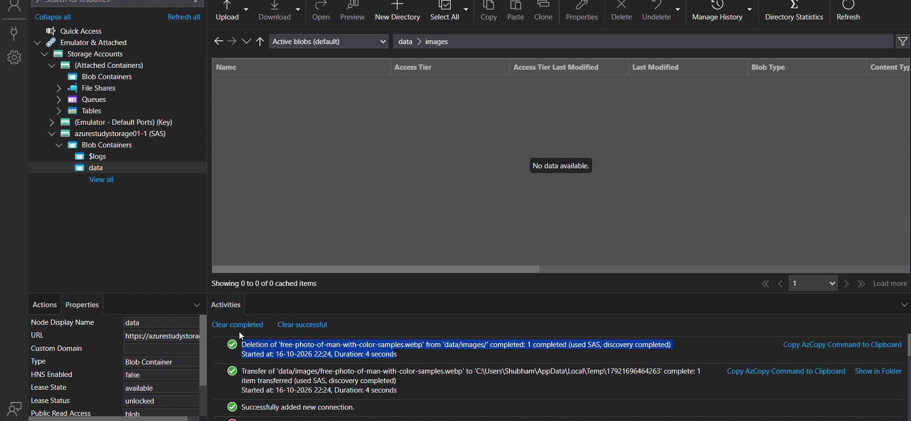

The asset is deleted under the strict authorization of our scoped Account SAS.

---

## Azure CLI Automation for SAS Generation

To generate SAS tokens programmatically within CI/CD deployment pipelines, execute the following Azure CLI commands:

```bash
# 1. Generate a Read-Only Service SAS for a specific blob (valid for 2 hours)
az storage blob generate-sas \
  --account-name azurestudystorage01 \
  --container-name data \
  --name "images/sample.webp" \
  --permissions r \
  --expiry $(date -u -d "2 hours" '+%Y-%m-%dT%H:%MZ') \
  --https-only \
  --auth-mode key \
  --output tsv

# 2. Generate a Container Service SAS with Read and List permissions
az storage container generate-sas \
  --account-name azurestudystorage01 \
  --name data \
  --permissions rl \
  --expiry $(date -u -d "8 hours" '+%Y-%m-%dT%H:%MZ') \
  --https-only \
  --auth-mode key \
  --output tsv

# 3. Generate an Account SAS for Blob services with Read, List, and Delete
az storage account generate-sas \
  --account-name azurestudystorage01 \
  --services b \
  --resource-types sco \
  --permissions rdl \
  --expiry $(date -u -d "8 hours" '+%Y-%m-%dT%H:%MZ') \
  --https-only \
  --output tsv
```

---

## Enterprise Security Best Practices

1. **Always Use HTTPS (`spr=https`):** Prevent man-in-the-middle (MITM) eavesdropping from intercepting valid SAS tokens over plain text HTTP.
2. **Minimize Expiration Windows:** Set SAS token lifetimes to the shortest duration necessary (e.g., minutes for web uploads, hours for batch ETL pipelines).
3. **Bind to IP Ranges (`sip`):** Restrict SAS token validity to corporate egress IP addresses or application gateway VIPs whenever possible.
4. **Use Stored Access Policies (SAPs) for Revocability:**
   - Standard Service SAS tokens cannot be revoked individually without regenerating the underlying Storage Account Key (which breaks all other SAS tokens signed by that key).
   - By associating a Service SAS with a **Stored Access Policy**, administrators can revoke access instantaneously by deleting or modifying the policy in the Azure Portal without touching account keys.
5. **Prefer User Delegation SAS for Blob Storage:** Backed by Microsoft Entra ID identities, eliminating storage account key dependency entirely.

---

## Cost Optimization and Cleanup

Operations performed with SAS tokens accrue standard storage transaction costs.

### Detaching Temporary SAS Connections:
1. In Storage Explorer, locate `data-1 (SAS)` under **(Attached Containers)**.
2. Right-click and choose **Detach**.
3. Locate `azurestudystorage01-1 (SAS)` under **Storage Accounts**.
4. Right-click and choose **Detach**.

### Cloud Resource Teardown:
```bash
# Delete the storage account if concluding storage experiments
az storage account delete \
  --name azurestudystorage01 \
  --resource-group azure-study \
  --yes
```

---

## Key Takeaways and Exam Tips (AZ-104)

- **Definition of SAS:** A URI query string that delegates granular, time-bound, permission-limited access to Azure Storage resources without sharing root access keys.
- **Service SAS vs. Account SAS:**
  - `Service SAS`: Scoped to a single storage service resource (one blob, one container, one table). Supports Stored Access Policies for easy revocation.
  - `Account SAS`: Scoped across one or more services (`Blob`, `File`, `Queue`, `Table`) and resource types (`Service`, `Container`, `Object`). Does NOT support Stored Access Policies.
- **User Delegation SAS:** The most secure SAS type for Blob storage because it is signed by Microsoft Entra ID user/service principal credentials, avoiding shared account keys entirely.
- **List vs. Read Trap:** To browse a container in Azure Portal or Storage Explorer, a client **must** have `List` (`l`) permission. Having `Read` (`r`) permission only allows fetching known blob URLs.
- **Revocation Mechanics:** To revoke an ad-hoc SAS immediately, you must regenerate the signing key (`key1` or `key2`). To avoid this blast radius, always use Stored Access Policies or User Delegation SAS.
