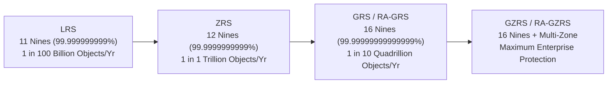
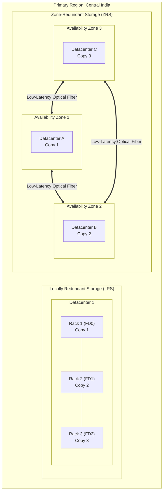
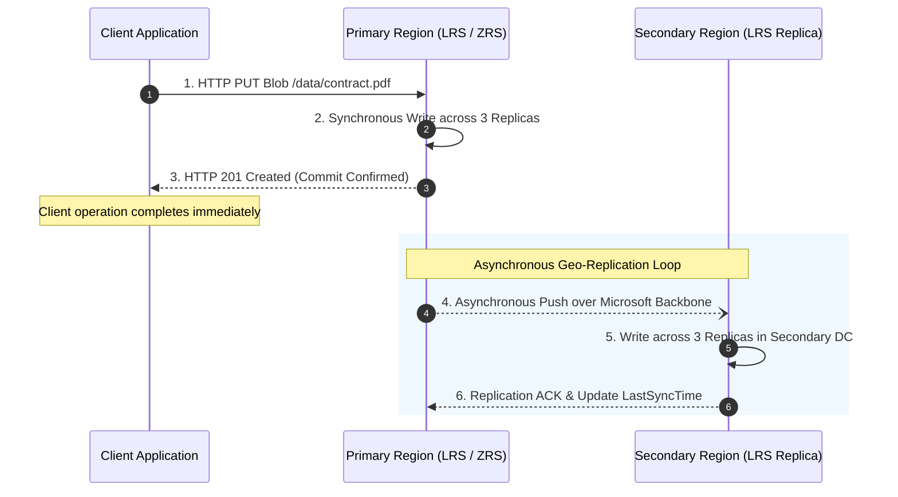
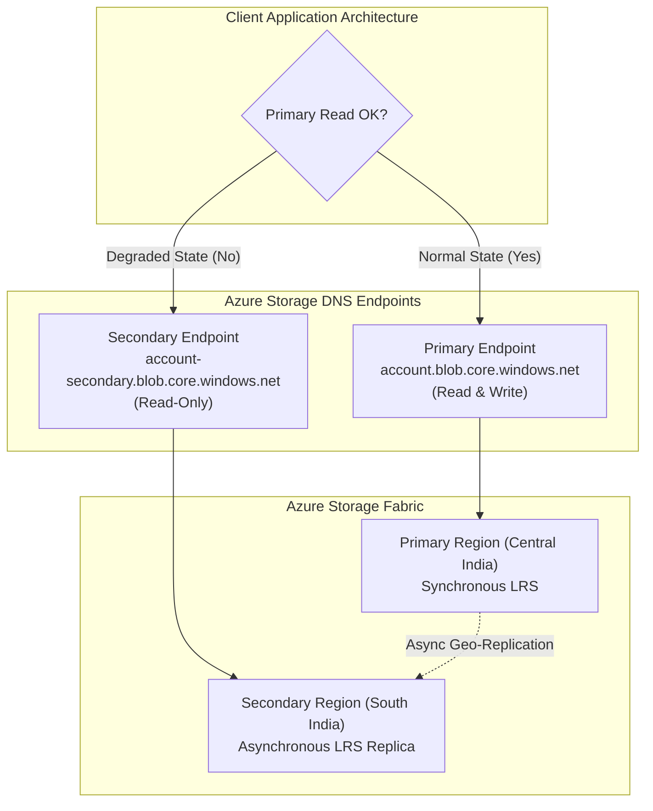
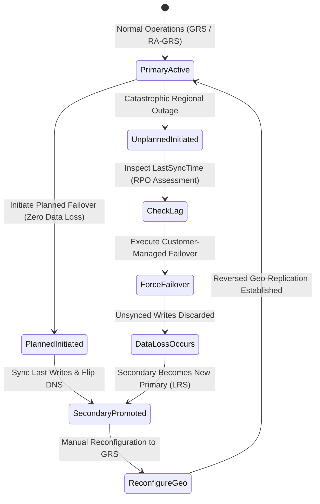
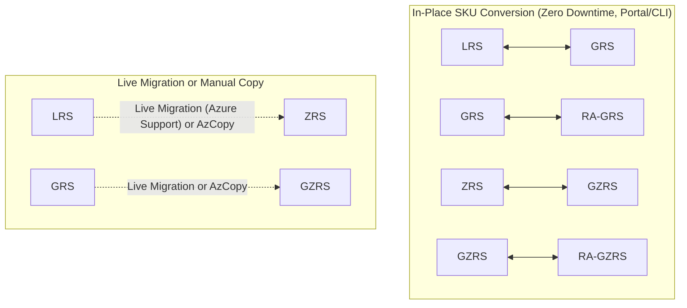
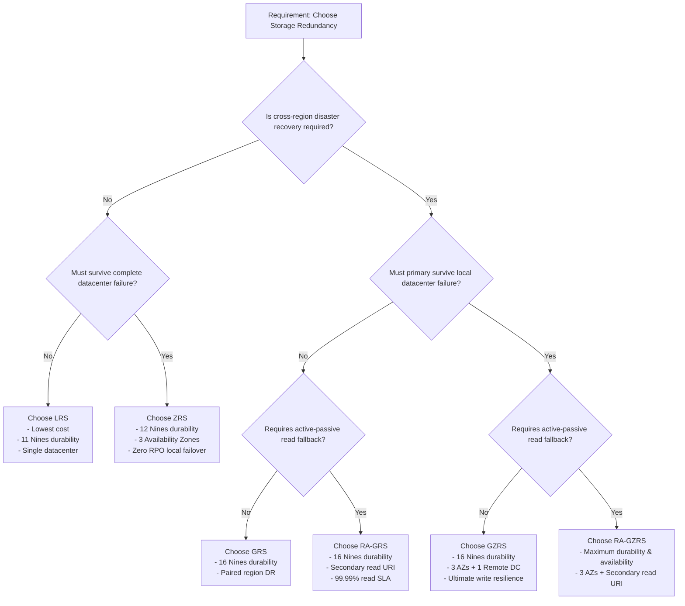

# Day 13: Azure Storage Redundancy Options: LRS, ZRS, GRS, RA-GRS, GZRS, and RA-GZRS Master Guide

*A definitive architectural guide to Azure Storage data durability and high availability: dissecting primary region replication (LRS vs. ZRS), cross-region geo-replication (GRS, RA-GRS, GZRS, RA-GZRS), the mathematics of 16 9s of durability, customer-managed failover mechanics, RPO/RTO analysis, and AZ-104 certification decision frameworks.*

---

## Executive Summary and The Resiliency Imperative

In cloud storage architecture, durability and availability are distinct but complementary requirements:
- **Durability** answers: *Will my data survive physical drive crashes, server node collapses, power outages, and catastrophic natural disasters over time?*
- **Availability** answers: *Can my client application read and write data right now with acceptable latency and without HTTP 503 or network timeout errors?*

Azure Storage delivers enterprise-grade durability by maintaining multiple physical copies of every stored object. Depending on your regulatory requirements, budget, latency sensitivity, and business continuity strategy, Microsoft Azure provides six primary replication models distributed across two geographic tiers:

1. **Primary Region Redundancy**: Protects against hardware failures and datacenter disasters within the local deployment region.
   - **Locally Redundant Storage (LRS)**: 3 synchronous copies within a single datacenter.
   - **Zone-Redundant Storage (ZRS)**: 3 synchronous copies distributed across 3 distinct Availability Zones.
2. **Secondary Region Redundancy (Geo-Redundancy)**: Protects against regional catastrophes (earthquakes, widespread power grid collapses, military conflict) by asynchronously replicating data to a paired secondary region hundreds of miles away.
   - **Geo-Redundant Storage (GRS)**: LRS in primary + LRS in secondary (6 copies total).
   - **Read-Access Geo-Redundant Storage (RA-GRS)**: GRS plus a dedicated read-only endpoint for secondary region reads.
   - **Geo-Zone-Redundant Storage (GZRS)**: ZRS in primary + LRS in secondary (6 copies across 4 physical datacenters).
   - **Read-Access Geo-Zone-Redundant Storage (RA-GZRS)**: GZRS plus a dedicated read-only endpoint for secondary region reads.

This guide provides a comprehensive technical exploration of each redundancy tier, their underlying replication protocols, failover mechanics, cost-durability trade-offs, and critical exam scenarios for the Microsoft AZ-104 certification.

---

## The Mathematics of Data Durability (The 9s)

Microsoft designs Azure Storage replication tiers to achieve specific annual durability ratings, expressed as percentages ("nines"):



### Statistical Reality of Durability Ratings

To understand what these numbers mean in enterprise practice:
- **11 Nines (LRS)**: If you store 1,000,000,000 (1 billion) blobs in Azure Storage with LRS, you can statistically expect to lose a single blob once every 100 years.
- **12 Nines (ZRS)**: If you store 1,000,000,000 (1 billion) blobs, you can statistically expect to lose a single blob once every 1,000 years.
- **16 Nines (GRS / GZRS)**: If you store 10,000,000,000 (10 billion) blobs, you can statistically expect to lose a single blob once every 1,000,000 years.

---

## Architectural Comparison Matrix

| Redundancy Option | Copies in Primary | Copies in Secondary | Total Physical Copies | Primary Replication | Secondary Replication | Designed Annual Durability | Read Availability SLA | Write Availability SLA | Secondary Read Access |
| :--- | :--- | :--- | :--- | :--- | :--- | :--- | :--- | :--- | :--- |
| **LRS** | 3 (Single DC) | 0 | 3 | Synchronous | None | 99.999999999% (11 9s) | 99.9% (Hot/Cool) | 99.9% | No |
| **ZRS** | 3 (Across 3 AZs)| 0 | 3 | Synchronous | None | 99.9999999999% (12 9s)| 99.9% (Hot/Cool) | 99.9% | No |
| **GRS** | 3 (Single DC) | 3 (Single DC) | 6 | Synchronous | Asynchronous | 99.99999999999999% (16 9s) | 99.9% (Hot/Cool) | 99.9% | No (Failover only) |
| **RA-GRS** | 3 (Single DC) | 3 (Single DC) | 6 | Synchronous | Asynchronous | 99.99999999999999% (16 9s) | 99.99% (Hot) / 99.9% (Cool) | 99.9% | **Yes** (Dedicated URI) |
| **GZRS** | 3 (Across 3 AZs)| 3 (Single DC) | 6 | Synchronous | Asynchronous | 99.99999999999999% (16 9s) | 99.9% (Hot/Cool) | 99.9% | No (Failover only) |
| **RA-GZRS** | 3 (Across 3 AZs)| 3 (Single DC) | 6 | Synchronous | Asynchronous | 99.99999999999999% (16 9s) | 99.99% (Hot) / 99.9% (Cool) | 99.9% | **Yes** (Dedicated URI) |

---

## Primary Region Redundancy: LRS vs. ZRS

Every storage account must replicate data within its primary region. The choice between LRS and ZRS determines whether your data can survive a physical building-level destruction.



### 1. Locally Redundant Storage (LRS)

#### Technical Architecture
- LRS replicates your data **three times synchronously within a single physical storage cluster** in a single datacenter within the primary region.
- Inside the datacenter, the three replicas are partitioned across distinct **Fault Domains (FDs)** and **Update Domains (UDs)**. This guarantees that individual physical drive degradation, server chassis power supply unit (PSU) burnout, or top-of-rack (ToR) network switch failures will not cause data loss.
- **Synchronous Write Path**: When a client application uploads a blob, Azure Storage writes the data blocks across all three replicas in parallel. The storage service returns an `HTTP 201 Created` only after all three replicas have acknowledged the write to disk.

#### Protection Boundaries
- **Protects Against**: Disk failures, server crashes, rack-level power failures, rolling hardware maintenance.
- **Vulnerable To**: Fire, flooding, seismic activity, prolonged building-wide power outages, or physical structural collapse of the datacenter facility.

#### Optimal Use Cases
1. **Development, Testing, and Staging Environments**: Cost-optimized storage where persistent catastrophic recovery is unnecessary.
2. **Regenerable or Ephemeral Data**: Scratch files, build artifacts, temporary video transcoding caches, or application session state.
3. **Data Governance & Sovereignty Constraints**: Legal jurisdictions that strictly prohibit data from replicating outside a single designated facility.
4. **Application-Level Replication**: Architectures that maintain their own geo-distributed replication across clouds or datacenters at the software layer.

---

### 2. Zone-Redundant Storage (ZRS)

#### Technical Architecture
- ZRS replicates your data **synchronously across three independent Azure Availability Zones** in the primary region.
- Each Availability Zone is a physically separated facility (or cluster of facilities) equipped with independent power substations, diesel backup generators, chilling plants, and diverse fiber networking routes.
- **Synchronous Cross-Zone Write Path**: When a client writes to a ZRS account, the write is transmitted concurrently across dedicated, ultra-low-latency high-bandwidth optical networks to all three zones. Azure Storage returns `HTTP 201 Created` only after the write successfully commits across multiple zones.
- **Zero RPO Failover**: If an entire Availability Zone experiences a catastrophic failure (e.g., city grid blackout or localized flood), no data is lost. Applications can immediately continue reading and writing to the remaining two zones without administrative intervention.

#### Latency Characteristics
Because the zones are separated by kilometers of physical distance to protect against localized disasters, ZRS incurs a minor round-trip latency overhead (typically 1 to 3 milliseconds) compared to LRS. For the vast majority of workloads, this overhead is negligible compared to the massive resiliency gain.

#### Optimal Use Cases
1. **Mission-Critical Production Systems**: Enterprise workloads requiring 99.99% availability and survival against entire facility collapses without cross-region complexity.
2. **Strict Data Residency Compliance**: Workloads that must remain within national or regulatory boundaries (e.g., EU GDPR, Swiss banking regulations) where paired regions cross national borders.
3. **High-Availability Compute Clusters**: VMs deployed across Availability Zones mounting common storage endpoints.

---

## Secondary Region Redundancy (Geo-Redundancy)

When business continuity mandates survival against regional catastrophes, primary region storage must be paired with secondary region storage.

### How Azure Regional Pairs Function
Microsoft clusters Azure regions into **Regional Pairs** situated within the same geographic boundaries (with exceptions like Brazil South), separated by at least 300 miles (480 kilometers) to ensure localized natural disasters cannot impact both regions concurrently.

- **Central India** is paired with **South India**.
- **East US** is paired with **West US**.
- **North Europe** is paired with **West Europe**.



### The Asynchronous Replication Paradigm (RPO vs. RTO)

> [!IMPORTANT]
> Replication from the primary region to the secondary region is **always asynchronous**. 

- **Recovery Point Objective (RPO)**: Because data is replicated asynchronously after the client receives write confirmation, writes executed within the last few seconds or minutes may not have reached the secondary region if a disaster strikes. The elapsed time between the last successful replication and the disaster represents your RPO (potential data loss).
- **Recovery Time Objective (RTO)**: The elapsed time required to detect the regional outage, declare a disaster, and initiate failover to promote the secondary region represents your RTO.
- **Monitoring Geo-Replication Lag**: Azure provides the `LastSyncTime` metric. Any writes committed prior to `LastSyncTime` are guaranteed to exist in the secondary region.

---

### 3. Geo-Redundant Storage (GRS)

- **Architecture**: Employs **LRS in the primary region** (3 copies in one DC) and replicates asynchronously to **LRS in the secondary paired region** (3 copies in one DC). Total: 6 copies.
- **Endpoint Behavior**: Under standard operations, the secondary region is completely passive and invisible. Applications cannot read from or write to the secondary region.
- **Accessing Secondary**: Data in the secondary region can only be accessed if Microsoft declares a regional disaster or if the customer manually initiates an **Account Failover**.

---

### 4. Read-Access Geo-Redundant Storage (RA-GRS)

- **Architecture**: Identical 6-replica underlying storage infrastructure as GRS (3 LRS primary + 3 LRS secondary).
- **The Secondary Read Endpoint**: Unlike GRS, RA-GRS provisions a dedicated secondary read-only DNS endpoint:
  - Primary Endpoint: `https://azurestudystorage01.blob.core.windows.net`
  - Secondary Read Endpoint: `https://azurestudystorage01-secondary.blob.core.windows.net`
- **Active-Passive Read Failover**: Applications can implement read fallback logic. If the primary region exhibits elevated latency or HTTP 500 errors, the client can redirect read queries to the secondary endpoint immediately.
- **Availability SLA Upgrade**: Increases read availability SLA from 99.9% to **99.99%** for Hot access tier.



---

### 5. Geo-Zone-Redundant Storage (GZRS)

- **Architecture**: The premier resiliency architecture for enterprise data. Combines **Zone-Redundant Storage (ZRS) in the primary region** (3 copies across 3 independent Availability Zones) with **Locally Redundant Storage (LRS) in the secondary paired region** (3 copies in one datacenter).
- **Total Protection**: 6 copies across **4 physically separated datacenters**.
- **Resiliency Profile**:
  - If a single datacenter collapses in the primary region, zero data loss and zero failover needed (ZRS handles it transparently).
  - If the entire primary region collapses, data is preserved in the secondary paired region.
- **Secondary Access**: Passive; accessible only upon initiating an Account Failover.

---

### 6. Read-Access Geo-Zone-Redundant Storage (RA-GZRS)

- **Architecture**: Identical to GZRS, but unlocks the secondary read-only endpoint (`https://<account>-secondary.blob.core.windows.net`).
- **Resiliency Profile**: Offers the maximum possible durability (16 nines) and maximum possible read availability (99.99%) available in the public cloud.

---

## Failover Mechanics: Customer-Managed vs. Planned Failover

When a primary region suffers an outage, how does secondary storage become operational?



### 1. Customer-Managed Unplanned Failover

If the primary region becomes completely unavailable and Microsoft has not declared a regional disaster, the customer can initiate an unplanned failover.

#### Execution Process
1. **Inspect Replication Lag**: Retrieve the storage account's `GeoReplicationStats` and examine `lastSyncTime`. Any write committed after `lastSyncTime` will be permanently lost.
2. **Trigger Failover**: Issue an `az storage account failover` command or trigger it via the Azure Portal.
3. **DNS Repointing**: Azure automatically repoints the primary DNS record (`<account>.blob.core.windows.net`) to the secondary region's IP addresses.
4. **Automatic Downgrade to LRS**: Upon completion of the failover, **the storage account is automatically converted to Locally Redundant Storage (LRS)** in the new primary region!
5. **Re-establishing Geo-Redundancy**: Because the account is now LRS, you must manually update the SKU back to GRS or RA-GRS to initiate replication to the new paired secondary.

> [!WARNING]
> Unplanned customer-managed failover is irreversible. Once triggered, the original primary region data is detached. If the original primary contained un-replicated writes, those writes are permanently lost.

---

### 2. Planned Failover (Preview / GA Rollout)

Planned failover is designed for disaster recovery drills, regulatory testing, and anticipated regional evacuations (e.g., approaching severe hurricanes):
1. **Zero Data Loss Guarantee**: Azure Storage halts incoming writes on the primary, synchronizes all outstanding replication queues to the secondary, and waits until replication lag reaches zero ($RPO = 0$).
2. **Seamless DNS Switch**: DNS records are switched to the secondary region.
3. **Automatic Reverse Replication**: The original primary automatically becomes the new secondary, establishing reverse geo-replication without manual SKU reconfiguration.

---

## Redundancy Migration Pathways

Enterprises frequently need to modify storage redundancy as workloads mature:



### Conversion Rules
- **LRS to GRS / RA-GRS**: Can be executed directly in the Azure Portal or via Azure CLI in seconds. Azure starts the initial asynchronous background sync to the secondary region without downtime.
- **GRS to RA-GRS (and vice versa)**: In-place instant toggle. Enforces or releases the `-secondary` DNS record.
- **LRS to ZRS**: In regions supporting live migration, you can request an in-place migration without downtime. Alternatively, use AzCopy or Azure Data Factory to copy data from an LRS account to a newly created ZRS account.

---

## Storage Account SKU and Service Support Matrix

Not all Azure Storage services or specialized tiers support every redundancy option:

| Storage Offering | Supported Redundancy Options | Unsupported Redundancy Options |
| :--- | :--- | :--- |
| **Standard General-Purpose v2 (GPv2)** | LRS, ZRS, GRS, RA-GRS, GZRS, RA-GZRS | None (Full Support) |
| **Premium Block Blobs** | LRS, ZRS | GRS, RA-GRS, GZRS, RA-GZRS |
| **Premium File Shares** | LRS, ZRS | GRS, RA-GRS, GZRS, RA-GZRS |
| **Premium Page Blobs (Unmanaged Disks)**| LRS | ZRS, GRS, RA-GRS, GZRS, RA-GZRS |
| **Azure Blob Storage (Legacy BlobStorage)** | LRS, GRS, RA-GRS | ZRS, GZRS, RA-GZRS |

---

## Architectural Decision Framework



---

## AZ-104 Exam Tips and High-Yield Traps

1. **Trap: Secondary Endpoint in RA-GRS Allows Writes**: 
   - *Exam Trick*: A question states: "The primary region is offline. You need to write emergency data to the secondary endpoint."
   - *Reality*: The secondary endpoint in RA-GRS / RA-GZRS is **strictly read-only**. Attempting an HTTP `PUT`, `POST`, or `DELETE` against `<account>-secondary.blob.core.windows.net` returns `HTTP 400 Bad Request` or `HTTP 403 Forbidden`. You cannot write to the secondary region without executing a full **Account Failover**.

2. **Trap: Storage SKU After Customer-Managed Failover**:
   - *Exam Trick*: A question asks: "You execute a customer failover of an RA-GRS storage account. What is the redundancy configuration of the storage account immediately following failover?"
   - *Reality*: The account drops to **LRS** in the new primary region. It does **not** remain RA-GRS or GRS. Geo-redundancy must be explicitly re-enabled.

3. **Trap: ZRS Data Residency**:
   - *Exam Trick*: A healthcare provider in Germany requires that data never leaves national borders. Can you use GRS?
   - *Reality*: No, because paired regions may cross borders (or violate specific facility bounds). **ZRS** guarantees all 3 replicas remain within the designated primary region while surviving complete datacenter collapse.

4. **Trap: Converting LRS to ZRS**:
   - *Exam Trick*: A question claims you can switch from LRS to ZRS instantly in the portal by simply changing the dropdown.
   - *Reality*: Switching from LRS to ZRS requires either **customer-initiated manual data copy (AzCopy)** or requesting a **Live Migration** from Azure support. You cannot simply flip a dropdown without underlying migration mechanics.

5. **Trap: Durability vs. Availability SLAs**:
   - Do not confuse durability (11 nines vs 16 nines) with availability (99.9% vs 99.99%). RA-GRS and RA-GZRS provide **99.99% read availability** by providing a secondary DNS fallback, but their data durability remains 16 nines identical to GRS.

---

## Production Automation: Azure CLI and PowerShell Reference

### 1. Inspecting Storage Account Redundancy and Replication State

```bash
# Query storage account SKU and redundancy tier
az storage account show \
  --name azurestudystorage01 \
  --resource-group azure-study \
  --query "{Name:name, SKU:sku.name, Tier:sku.tier, Location:location}" \
  --output table
```

### 2. Inspecting Geo-Replication Status and LastSyncTime

```bash
# Check replication status and determine potential data loss (RPO)
az storage account show \
  --name azurestudystorage01 \
  --resource-group azure-study \
  --query "geoReplicationStats" \
  --output json
```

*Example JSON Output:*
```json
{
  "canFailover": true,
  "canPlannedFailover": true,
  "lastSyncTime": "2026-10-19T14:48:12.000000+00:00",
  "status": "Live"
}
```

### 3. Converting Storage Account Redundancy In-Place

```bash
# Update from LRS to GRS (Initiates asynchronous background replication)
az storage account update \
  --name azurestudystorage01 \
  --resource-group azure-study \
  --sku Standard_GRS

# Promote GRS to RA-GRS (Enables secondary read endpoint)
az storage account update \
  --name azurestudystorage01 \
  --resource-group azure-study \
  --sku Standard_RAGRS
```

### 4. Initiating an Unplanned Customer-Managed Failover

```bash
# Execute customer failover (Drops account to LRS in secondary region)
az storage account failover \
  --name azurestudystorage01 \
  --resource-group azure-study \
  --yes
```

### 5. Initiating a Planned Failover (Zero Data Loss)

```bash
# Execute planned failover with zero RPO data loss
az storage account failover \
  --name azurestudystorage01 \
  --resource-group azure-study \
  --failover-type Planned \
  --yes
```

---

## Summary Reference Table

| Feature / Criteria | LRS | ZRS | GRS | RA-GRS | GZRS | RA-GZRS |
| :--- | :--- | :--- | :--- | :--- | :--- | :--- |
| **Number of Replicas** | 3 | 3 | 6 | 6 | 6 | 6 |
| **Physical Facilities** | 1 Datacenter | 3 Zones | 2 Datacenters | 2 Datacenters | 4 Datacenters (3 Zones + 1 DC) | 4 Datacenters (3 Zones + 1 DC) |
| **Replication Protocol** | Synchronous | Synchronous | Sync (Primary) + Async (Secondary) | Sync (Primary) + Async (Secondary) | Sync (Primary) + Async (Secondary) | Sync (Primary) + Async (Secondary) |
| **Durability (Nines)** | 11 Nines | 12 Nines | 16 Nines | 16 Nines | 16 Nines | 16 Nines |
| **Read Availability** | 99.9% | 99.9% | 99.9% | **99.99%** | 99.9% | **99.99%** |
| **Write Availability** | 99.9% | 99.9% | 99.9% | 99.9% | 99.9% | 99.9% |
| **Secondary Read URI** | No | No | No | **Yes** | No | **Yes** |
| **Relative Cost Multiplier** | 1.0x (Base) | ~1.25x - 1.5x | ~2.0x | ~2.5x | ~2.5x - 2.8x | ~3.0x |

---

## Conclusion

Understanding Azure Storage redundancy is not merely about memorizing acronyms—it is about translating business continuity requirements, RPO/RTO thresholds, and budgetary constraints into resilient cloud infrastructure. By mastering the differences between synchronous primary replication and asynchronous geo-replication, cloud architects ensure that enterprise data survives both localized hardware faults and catastrophic regional disasters.
