# Day 14: Azure Storage Access Tiers and Lifecycle Management: Automated Tiering, Cost Optimization, and Rehydration Master Guide

*A definitive architectural and hands-on guide to mastering Azure Blob Storage access tiers and automated lifecycle management: dissecting the four tiers (Hot, Cool, Cold, Archive), early deletion penalties, archive rehydration mechanics (Standard vs. High priority), declarative ARM JSON policies, and multi-subtype tiering across base blobs, snapshots, and versions.*

---

## Executive Summary and Learning Objectives

In enterprise cloud deployments, unstructured data grows exponentially. Application logs, compliance archives, database backups, media assets, and analytics telemetry accumulate rapidly. Storing all data indiscriminately in the highest-performance storage tier results in unsustainable cloud expenditure, while prematurely archiving data can introduce severe latency and unexpected retrieval charges.

To optimize the balance between performance and cost, Microsoft Azure provides **Azure Blob Storage Access Tiers** and automated **Blob Lifecycle Management**:
- **Access Tiers** categorize data based on access frequency, retention duration, and retrieval latency: **Hot**, **Cool**, **Cold**, and **Archive**.
- **Lifecycle Management** provides a rule-based declarative engine that automatically transitions blobs between access tiers or purges them at the end of their useful lifecycle based on temporal attributes (last modified, created, or last accessed).

In this practical lab, we explore the official Microsoft documentation architecture for access tiers, inspect how blobs inherit inferred tiers from account defaults, examine the "Change tier" mechanics in the Azure Portal, and build an end-to-end multi-action Lifecycle Management policy targeting base blobs, snapshots, and versions. We culminate by dissecting the underlying declarative ARM JSON policy representation.

### Key Skills Acquired
- Analyzing the architectural and billing profiles of the four access tiers: **Hot**, **Cool**, **Cold**, and **Archive**.
- Demystifying the difference between **Account-Level Default Tiers** and **Blob-Level Explicit vs. Inferred Tiering**.
- Calculating minimum storage duration thresholds and early deletion penalties (30 days for Cool, 90 days for Cold, 180 days for Archive).
- Mastering **Archive Rehydration** workflows: Standard Priority (up to 15 hours) vs. High Priority (under 1 hour), and in-place rehydration (`SetBlobTier`) vs. copy-based rehydration (`CopyBlob`).
- Provisioning multi-action **Lifecycle Management Rules** in the Azure Portal targeting base blobs, snapshots, and versions simultaneously.
- Configuring rehydration protection buffers (`daysAfterLastTierChangeGreaterThan`) to prevent rehydration loops.
- Decoding declarative ARM JSON lifecycle management schemas in Code View.
- Automating access tier changes and lifecycle policy deployments using the Azure CLI.

---

## Part 1: Architectural Deep Dive: Azure Storage Access Tiers

According to the official Microsoft documentation ([Azure Blob Storage Access Tiers Overview](https://learn.microsoft.com/en-us/azure/storage/blobs/access-tiers-overview)), Azure Storage provides four distinct tiers tailored to specific data access patterns:

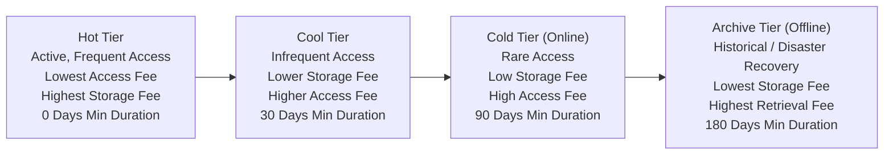

### 1. The Four Access Tiers Compared

#### A. Hot Tier
- **Access Pattern**: Actively read, written, and modified daily.
- **Latency**: Sub-millisecond to low single-digit millisecond latency.
- **Cost Profile**: Highest storage capacity cost; lowest read/write transaction and data access costs.
- **Minimum Storage Duration**: None (0 days). Blobs can be created, updated, or deleted immediately with zero early deletion penalties.
- **Availability SLA**: 99.9% for LRS/ZRS/GRS; 99.99% for RA-GRS/RA-GZRS.
- **Default Account Tier**: Can be set as the default tier for the entire storage account.

#### B. Cool Tier
- **Access Pattern**: Infrequently accessed data expected to remain stored for at least 30 days.
- **Latency**: Low single-digit millisecond latency (identical online performance to Hot).
- **Cost Profile**: Significantly lower capacity cost than Hot; higher read and retrieval fees.
- **Minimum Storage Duration**: **30 days**. If a blob is deleted, overwritten, or moved to a warmer tier (Hot) before 30 days, an early deletion charge is assessed for the remaining days.
- **Availability SLA**: 99.0% for LRS/ZRS/GRS; 99.9% for RA-GRS/RA-GZRS.
- **Default Account Tier**: Can be set as the default tier for the storage account.
- **Common Use Cases**: Short-term backups, application staging data, telemetry logs, media raw footage.

#### C. Cold Tier (Online Storage)
- **Access Pattern**: Rarely accessed data expected to remain stored for at least 90 days.
- **Latency**: Low single-digit millisecond latency (remains **online** and instantly readable, unlike Archive).
- **Cost Profile**: Up to 60-70% lower capacity cost than Cool; higher read transaction and data retrieval fees.
- **Minimum Storage Duration**: **90 days**. Deleting or promoting a cold blob before 90 days incurs an early deletion penalty.
- **API Requirement**: Requires Azure Storage REST API version `2021-12-02` or later.
- **Default Account Tier**: Cannot be set as the default account tier (must be applied at the blob or lifecycle policy level).
- **Common Use Cases**: Quarterly financial reports, audit compliance logs that must be instantly queryable without rehydration delays, secondary backup archives.

#### D. Archive Tier (Offline Storage)
- **Access Pattern**: Historical data, compliance evidence, and deep backups accessed less than once a year.
- **Latency**: **Offline**. Blobs cannot be read or downloaded directly. Data must be rehydrated to Hot, Cool, or Cold before access.
- **Cost Profile**: Lowest capacity cost (up to 90% cheaper than Hot); highest retrieval and transaction fees.
- **Minimum Storage Duration**: **180 days**. Deleting or rehydrating a blob before 180 days incurs early deletion charges for the remaining days.
- **Availability SLA**: Offline storage; no real-time read availability SLA.
- **Default Account Tier**: Cannot be set as the default account tier.

---

### Access Tier Specification Matrix

| Metric / Dimension | Hot Tier | Cool Tier | Cold Tier | Archive Tier |
| :--- | :--- | :--- | :--- | :--- |
| **Operational State** | Online | Online | Online | **Offline** |
| **Read Latency** | Milliseconds | Milliseconds | Milliseconds | **Hours (Rehydration Required)** |
| **Storage Capacity Cost** | Highest | Low | Lower | **Lowest (Up to 90% Off)** |
| **Data Access / Retrieval Fee**| None | Moderate | High | **Highest** |
| **Transaction Costs (Read/Write)**| Lowest | Moderate | High | **Highest** |
| **Minimum Storage Duration** | 0 Days | **30 Days** | **90 Days** | **180 Days** |
| **Early Deletion Penalty** | None | Yes (Pro-rated for 30d) | Yes (Pro-rated for 90d) | Yes (Pro-rated for 180d) |
| **Can Set as Account Default?** | Yes | Yes | No | No |
| **Read Availability SLA (LRS)** | 99.9% | 99.0% | 99.0% | N/A (Offline) |
| **Read Availability SLA (RA-GRS)**| 99.99% | 99.9% | 99.9% | N/A (Offline) |

---

## The Economics of Storage Tiering: When Does Moving Data Save Money?

A common operational anti-pattern is moving actively accessed data to Cool or Cold tiers under the assumption that it will reduce costs. 

Total storage cost consists of three billing components:
$$\text{Total Cost} = \text{Capacity Cost} + \text{Operation/Transaction Cost} + \text{Data Access/Retrieval Cost}$$

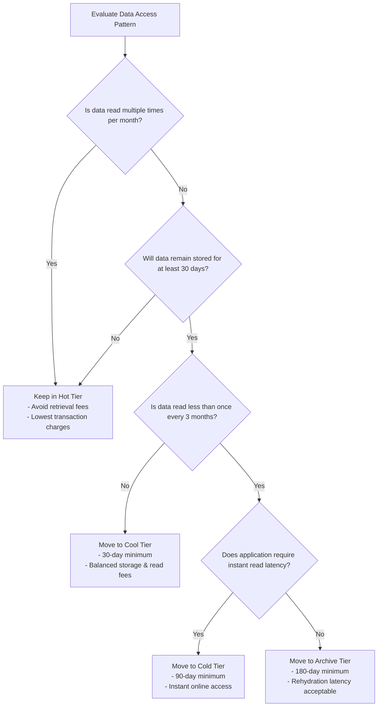

> [!WARNING]
> If a 1 TB dataset in the Cool or Cold tier is read in its entirety every week, the cumulative **Data Access (Retrieval) Fees** will exceed the storage capacity savings, resulting in a significantly higher monthly bill than if the data had remained in the Hot tier.

---

## Blob-Level Tiering: Inferred vs. Explicit Tiers

Within Azure Storage, blobs possess one of two tier states:
1. **Inferred Tier**: When a blob is uploaded without specifying an access tier, it inherits the storage account's default access tier. In the Azure Portal, this is displayed as `Hot (Inferred)` or `Cool (Inferred)`.
   - *Advantage*: If the account-level default tier is toggled from Hot to Cool, all inferred blobs automatically transition to Cool without requiring individual REST transactions or incurring write transaction charges.
2. **Explicit Tier**: When an access tier is explicitly assigned to a blob (via the Azure Portal "Change tier" action, Azure CLI, SDK, or Lifecycle Management policy), the blob's metadata records the tier permanently. Changing the account-level default tier will **not** affect explicitly tiered blobs.

---

## Archive Rehydration Architecture

Because the Archive tier is offline, attempting to read, download, or stream an archived blob directly returns an HTTP 409 Conflict error (`BlobArchived`). To access archived data, you must initiate **Rehydration**.

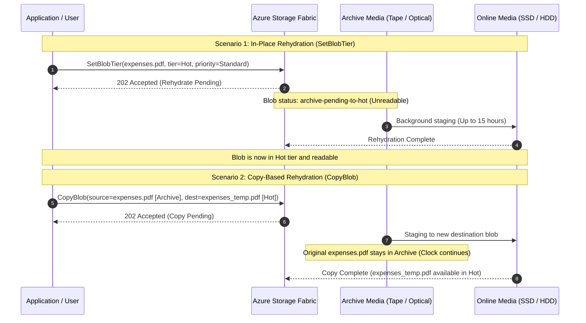

### Rehydration Priorities

| Parameter | Standard Priority | High Priority |
| :--- | :--- | :--- |
| **Processing Order** | First-In, First-Out (FIFO) queue | Prioritized queue |
| **Retrieval Duration** | Up to **15 hours** | **Under 1 hour** (for blobs $< 10\text{ GB}$) |
| **Cost Profile** | Standard retrieval fee | Premium retrieval fee (higher transaction cost) |
| **Optimal Use Case** | Scheduled batch ETL jobs, periodic compliance audits | Critical production outages, emergency legal discovery |

### In-Place Rehydration vs. Copy-Based Rehydration
1. **In-Place Rehydration (`SetBlobTier`)**: Modifies the archived blob's tier directly.
   - *Limitation*: If the blob has been in Archive for fewer than 180 days, an early deletion penalty is charged for the remaining days of the 180-day commitment!
2. **Copy-Based Rehydration (`CopyBlob`)**: Issues an asynchronous copy to a new blob name in Hot or Cool tier.
   - *Advantage*: The original blob remains in the Archive tier, preserving its 180-day retention clock and avoiding premature tier change penalties.

---

## Part 2: Step-by-Step Hands-On Implementation: Blob Lifecycle Management

### Phase 1: Inspecting Storage Account Overview and Inferred Access Tiers

1. Open the Azure Portal and navigate to the storage account `azurestudystorage01`.
2. Inspect the **Essentials** section on the **Overview** blade.

<div style="text-align: center; margin: 1.5rem 0;">
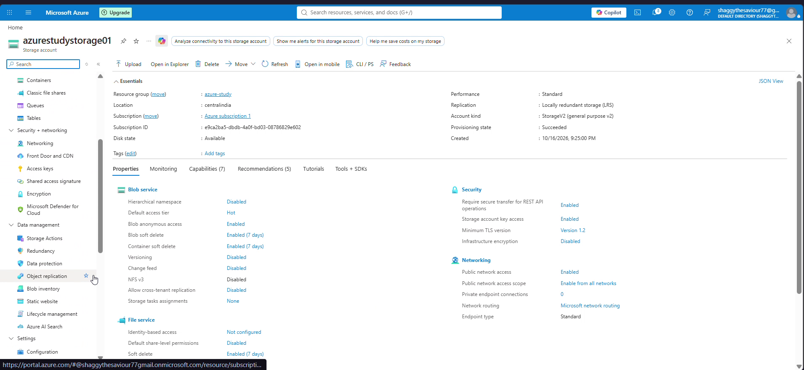
<p style="font-size: 0.85rem; color: #666; margin-top: 0.5rem;">Figure 1: Storage account overview displaying Account kind StorageV2, Performance Standard, and Default access tier Hot.</p>
</div>

- **Account kind**: `StorageV2 (general purpose v2)`
- **Default access tier**: `Hot`
- **Replication**: `Locally redundant storage (LRS)`

3. Under **Data storage**, select **Containers**, open `data`, and navigate to the virtual folder `DOCUMENTS`.

<div style="text-align: center; margin: 1.5rem 0;">
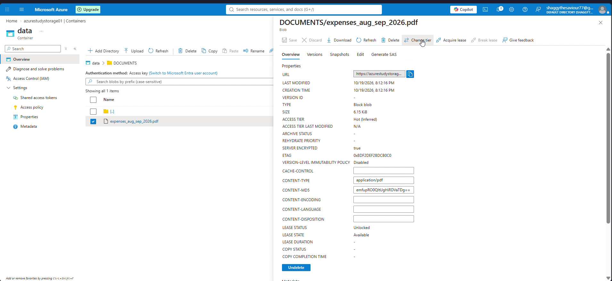
<p style="font-size: 0.85rem; color: #666; margin-top: 0.5rem;">Figure 2: Blob expenses_aug_sep_2026.pdf displaying an inferred access tier of Hot (Inferred).</p>
</div>

Notice that `expenses_aug_sep_2026.pdf` displays an access tier of **`Hot (Inferred)`**. Because no explicit tier was specified during upload, the blob automatically inherited the storage account's default tier.

---

### Phase 2: Examining the Manual "Change Tier" Panel

1. Select the checkbox next to `expenses_aug_sep_2026.pdf`.
2. In the top action bar, click the ellipsis (`...`) or select **Change tier**.

<div style="text-align: center; margin: 1.5rem 0;">
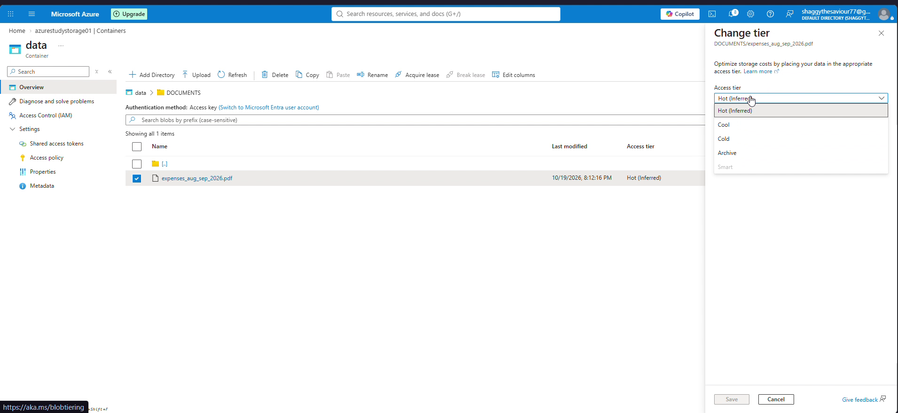
<p style="font-size: 0.85rem; color: #666; margin-top: 0.5rem;">Figure 3: Manual Change tier flyout revealing Hot (Inferred), Cool, Cold, and Archive options.</p>
</div>

The flyout reveals the four selectable access tiers:
- `Hot (Inferred)`
- `Cool`
- `Cold`
- `Archive`

While manual tiering is effective for isolated files, managing thousands or millions of blobs manually is operationally impossible. This is where automated **Lifecycle Management** becomes indispensable.

---

### Phase 3: Reviewing Billing Rules in Microsoft Documentation

Within the lab recording, the user consulted the official Microsoft Learn documentation to review the billing impacts of tier transitions:

<div style="text-align: center; margin: 1.5rem 0;">
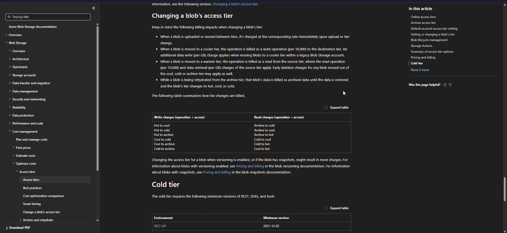
<p style="font-size: 0.85rem; color: #666; margin-top: 0.5rem;">Figure 4: Official Microsoft Learn reference detailing write charges, read retrieval charges, and early deletion penalties.</p>
</div>

#### Key Billing Principles:
1. **Tier Changes Incur Immediate Billing**: Changing a blob's tier charges the new rate immediately upon completion of the tier modification.
2. **Cooler Transitions Incur Write Operations**: Moving a blob to a cooler tier (Hot -> Cool, Cool -> Archive) is billed as a write operation (per 10,000) against the destination tier.
3. **Warmer Transitions Incur Read and Retrieval Operations**: Moving a blob to a warmer tier (Cool -> Hot, Archive -> Hot) is billed as a read operation (per 10,000) **plus** a data retrieval fee (per GB) from the source tier.
4. **Early Deletion Penalties Apply**: If a blob in Cool, Cold, or Archive is deleted, overwritten, or moved to a warmer tier before its minimum threshold (30, 90, or 180 days), an early deletion penalty is assessed for the remainder of the commitment window.

---

### Phase 4: Constructing a Multi-Action Lifecycle Management Policy

1. Return to the storage account `azurestudystorage01`.
2. In the left navigation menu under **Data management**, select **Lifecycle management**.

<div style="text-align: center; margin: 1.5rem 0;">
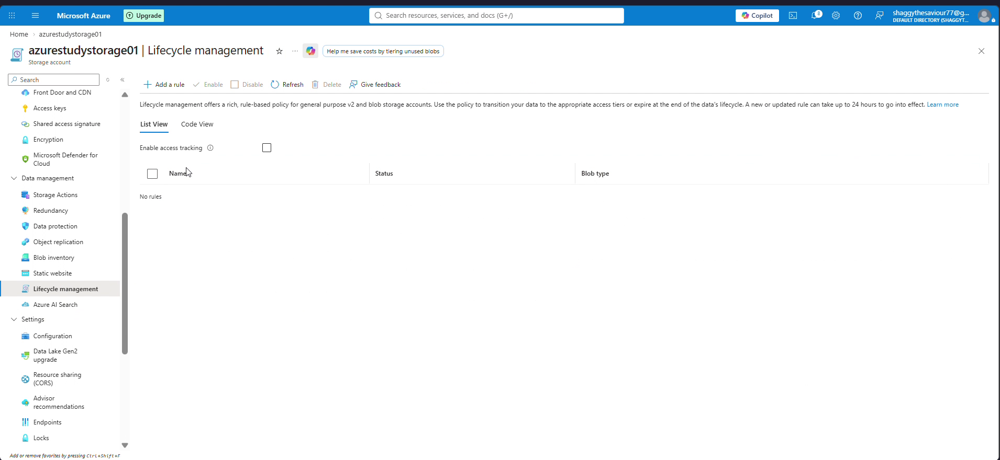
<p style="font-size: 0.85rem; color: #666; margin-top: 0.5rem;">Figure 5: The Lifecycle management blade providing List View, Code View, and rule provisioning.</p>
</div>

3. Click **+ Add a rule** to open the rule authoring wizard.

#### Step 1: Rule Details Configuration
- **Rule name**: Enter `MOVE_TO_COOL_TIER`.
- **Rule scope**: Select `Apply rule to all blobs in your storage account`.
- **Blob type**: Check `Block blobs` and `Append blobs`.
- **Blob subtype**: Check all three options:
  - `Base blobs`
  - `Snapshots`
  - `Versions`

<div style="text-align: center; margin: 1.5rem 0;">
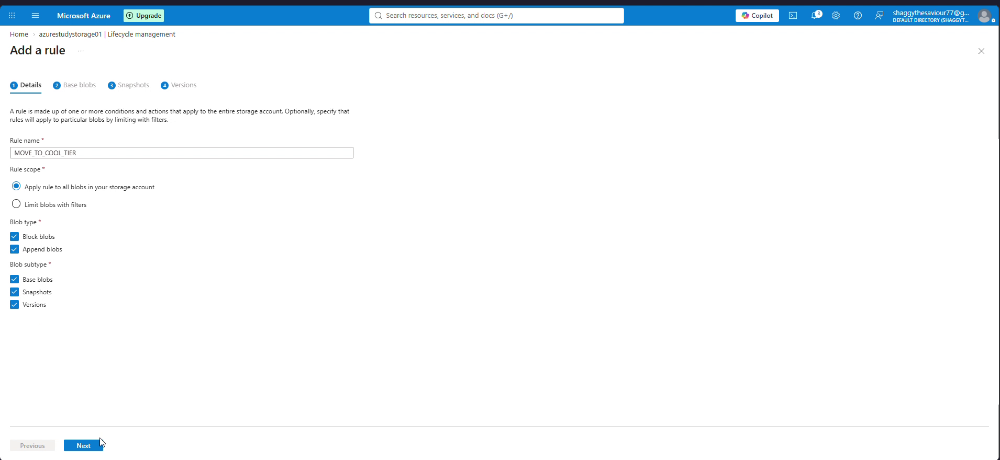
<p style="font-size: 0.85rem; color: #666; margin-top: 0.5rem;">Figure 6: Configuring rule details targeting Block/Append blobs across Base blobs, Snapshots, and Versions.</p>
</div>

Click **Next**.

---

#### Step 2: Base Blobs Action Conditions
We define two sequential tier transitions for base blobs:

1. **Condition 1 (Move to Cool)**:
   - **If**: `Base blobs were` -> `Last modified`
   - **More than (days ago)**: `30`
   - **Then**: `Move to cool storage`

<div style="text-align: center; margin: 1.5rem 0;">

<p style="font-size: 0.85rem; color: #666; margin-top: 0.5rem;">Figure 7: Defining the primary base blob condition: move to cool storage if last modified more than 30 days ago.</p>
</div>

2. Click **+ Add conditions** to create **Condition 2 (Move to Archive)**:
   - **If**: `Base blobs were` -> `Created`
   - **More than (days ago)**: `365`
   - **Then**: `Move to archive storage`
   - **Rehydration Protection**: Check `Skip blobs that have been rehydrated in the last 7 days`.
     - *Why this is critical*: If an administrator rehydrates an archived blob to perform an audit, you do not want the daily lifecycle engine to immediately re-archive it on the next sweep! This setting introduces a 7-day operational safety window.

<div style="text-align: center; margin: 1.5rem 0;">
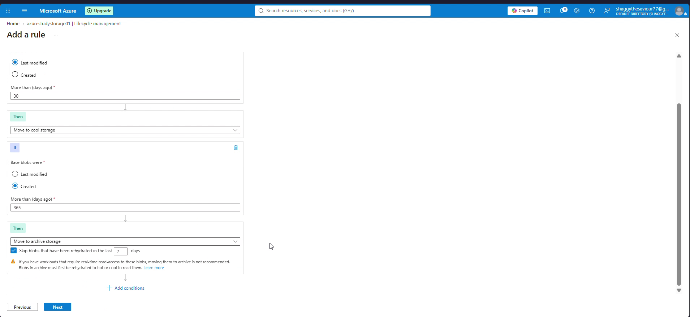
<p style="font-size: 0.85rem; color: #666; margin-top: 0.5rem;">Figure 8: Adding a secondary archive transition rule at 365 days with a 7-day rehydration buffer.</p>
</div>

Click **Next**.

---

#### Step 3: Snapshots Action Conditions
Snapshots represent point-in-time read-only copies of blobs. While invaluable for recovery, retaining snapshots in the Hot tier generates unnecessary storage fees.

- **If**: `Snapshots were Created More than (days ago)`: `30`
- **Then**: Select `Move to cold storage`.

<div style="text-align: center; margin: 1.5rem 0;">
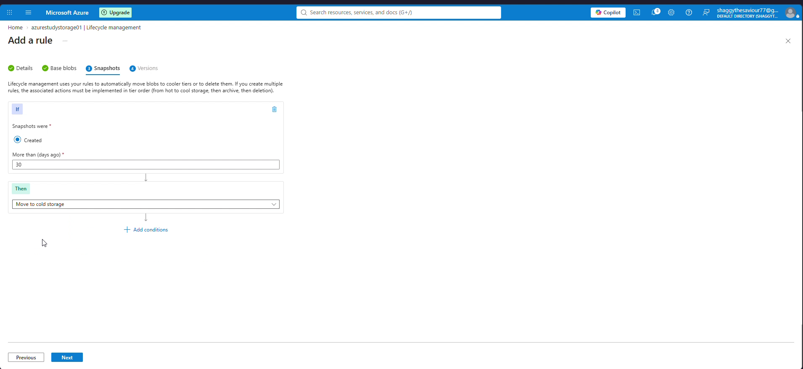
<p style="font-size: 0.85rem; color: #666; margin-top: 0.5rem;">Figure 9: Configuring snapshot lifecycle action to move snapshots to cold storage after 30 days.</p>
</div>

Click **Next**.

---

#### Step 4: Versions Action Conditions
Blob versioning automatically preserves previous states upon overwrite or deletion. Older versions should be transitioned to cooler tiers.

- **If**: `Versions were Created More than (days ago)`: `30`
- **Then**: Select `Move to cool storage`.

<div style="text-align: center; margin: 1.5rem 0;">
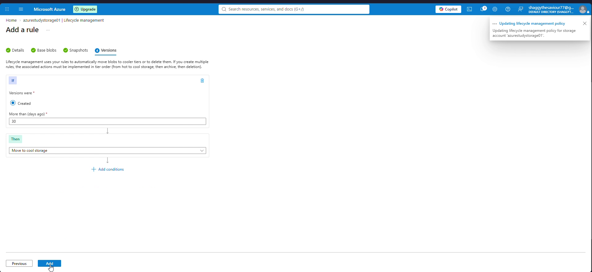
<p style="font-size: 0.85rem; color: #666; margin-top: 0.5rem;">Figure 10: Configuring version lifecycle action to move older blob versions to cool storage after 30 days.</p>
</div>

Click **Add**. Azure persists the lifecycle policy to the storage account.

---

### Phase 5: Verification in List View and Declarative Code View

Upon submission, Azure confirms policy creation:
`Successfully updated lifecycle management policy for storage account 'azurestudystorage01'.`

<div style="text-align: center; margin: 1.5rem 0;">
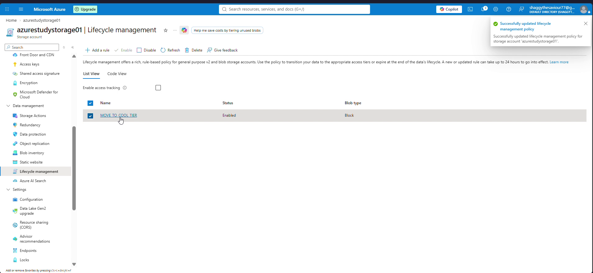
<p style="font-size: 0.85rem; color: #666; margin-top: 0.5rem;">Figure 11: The active lifecycle management policy displayed in List View with Enabled status.</p>
</div>

In the **List View**, the rule is displayed:
- **Name**: `MOVE TO COOL TIER`
- **Status**: `Enabled`
- **Blob type**: `Block`

Now, switch to the **Code View** tab to inspect the exact underlying JSON document deployed to Azure Resource Manager:

<div style="text-align: center; margin: 1.5rem 0;">
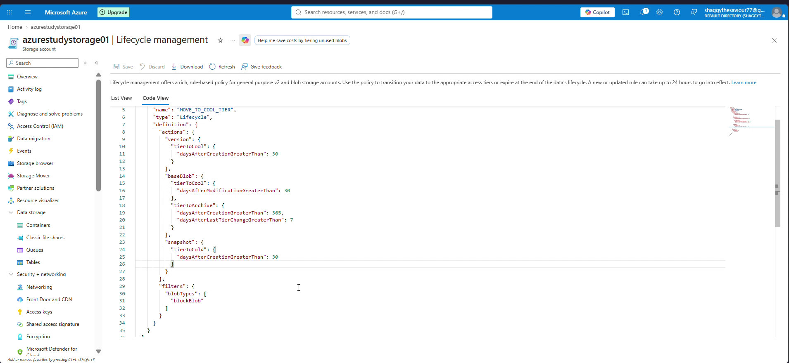
<p style="font-size: 0.85rem; color: #666; margin-top: 0.5rem;">Figure 12: Code View displaying the declarative ARM JSON lifecycle management policy definition.</p>
</div>

#### Declarative JSON Policy Dissection

```json
{
  "name": "MOVE_TO_COOL_TIER",
  "type": "Lifecycle",
  "definition": {
    "actions": {
      "version": {
        "tierToCool": {
          "daysAfterCreationGreaterThan": 30
        }
      },
      "baseBlob": {
        "tierToCool": {
          "daysAfterModificationGreaterThan": 30
        },
        "tierToArchive": {
          "daysAfterCreationGreaterThan": 365,
          "daysAfterLastTierChangeGreaterThan": 7
        }
      },
      "snapshot": {
        "tierToCold": {
          "daysAfterCreationGreaterThan": 30
        }
      }
    },
    "filters": {
      "blobTypes": [
        "blockBlob"
      ]
    }
  }
}
```

#### JSON Schema Breakdown:
1. **`actions.version.tierToCool`**: Evaluates blob versions; if `daysAfterCreationGreaterThan: 30`, transitions the version to Cool storage.
2. **`actions.baseBlob.tierToCool`**: Evaluates primary active blobs; if `daysAfterModificationGreaterThan: 30`, transitions the base blob to Cool storage.
3. **`actions.baseBlob.tierToArchive`**: If `daysAfterCreationGreaterThan: 365`, transitions base blob to Archive storage. Crucially, the sub-property `daysAfterLastTierChangeGreaterThan: 7` prevents newly rehydrated blobs from being re-archived during their 7-day operational window.
4. **`actions.snapshot.tierToCold`**: Evaluates point-in-time snapshots; if `daysAfterCreationGreaterThan: 30`, moves snapshots to the cost-effective Cold tier.
5. **`filters.blobTypes`**: Restricts the rule execution strictly to `blockBlob` types.

---

## Lifecycle Execution Mechanics and Operational Rules

Understanding how the Azure Storage lifecycle engine processes rules prevents common operational confusion:

1. **Daily Execution Schedule**: The lifecycle policy engine executes once per day across the storage cluster. It does not run continuously in real time.
2. **First Execution Latency**: When a new rule is created or an existing rule is updated, it can take up to **24 to 48 hours** for the initial policy execution to take effect across existing blobs.
3. **Action Hierarchy Enforcement**: Lifecycle management rules must strictly follow logical tier progression from warmer to cooler tiers:
   $$\text{Hot} \longrightarrow \text{Cool} \longrightarrow \text{Cold} \longrightarrow \text{Archive} \longrightarrow \text{Delete}$$
   You cannot author a rule that transitions data from Cool to Hot, or from Archive to Cool.
4. **Prefix Filter Limits**: Up to 10 prefix filters can be specified per rule to target specific container folders (e.g., `data/logs/`, `backup/archive/`).

---

## Production Automation: Azure CLI Reference Guide

### 1. Setting and Modifying Access Tiers via CLI

#### Check Current Blob Tier
```bash
az storage blob show \
  --account-name azurestudystorage01 \
  --container-name data \
  --name DOCUMENTS/expenses_aug_sep_2026.pdf \
  --query "{Name:name, Tier:properties.blobTier, Inferred:properties.blobTierInferred}" \
  --output table \
  --auth-mode key
```

#### Change Blob Tier to Cool
```bash
az storage blob set-tier \
  --account-name azurestudystorage01 \
  --container-name data \
  --name DOCUMENTS/expenses_aug_sep_2026.pdf \
  --tier Cool \
  --auth-mode key
```

#### Rehydrate an Archived Blob to Hot with High Priority
```bash
az storage blob set-tier \
  --account-name azurestudystorage01 \
  --container-name data \
  --name DOCUMENTS/expenses_aug_sep_2026.pdf \
  --tier Hot \
  --rehydrate-priority High \
  --auth-mode key
```

---

### 2. Managing Lifecycle Management Policies via CLI

#### Deploy Lifecycle Policy from JSON File
Save the policy schema to `policy.json` and deploy:
```bash
az storage account management-policy create \
  --account-name azurestudystorage01 \
  --resource-group azure-study \
  --policy @policy.json
```

#### Retrieve Active Lifecycle Policy
```bash
az storage account management-policy show \
  --account-name azurestudystorage01 \
  --resource-group azure-study \
  --output json
```

#### Delete Lifecycle Policy
```bash
az storage account management-policy delete \
  --account-name azurestudystorage01 \
  --resource-group azure-study
```

---

## AZ-104 Exam Tips and High-Yield Traps

1. **Trap: Archive as Default Account Tier**:
   - *Exam Trick*: A question asks: "You want all blobs uploaded to a storage account to be placed directly in the Archive tier by default. What setting should you configure on the storage account?"
   - *Reality*: The Archive tier **cannot** be configured as the storage account default tier. Only **Hot** and **Cool** can serve as default account tiers. Archiving must be performed via explicit blob upload, SDK parameters, or a Lifecycle Management policy.

2. **Trap: Cold Tier vs. Archive Tier Latency**:
   - *Exam Trick*: A scenario describes financial reports that must be preserved for 90 days at lowest cost, but must be readable by auditors immediately without waiting hours for rehydration. Which tier should you choose?
   - *Reality*: Choose **Cold**. Cold is an **online** tier with millisecond read latency, whereas Archive is offline and requires hours of rehydration.

3. **Trap: Early Deletion Penalty on Rehydrated Blobs**:
   - *Exam Trick*: A blob stored in Archive for 30 days is rehydrated to Hot. How is the early deletion penalty billed?
   - *Reality*: The Archive tier has a **180-day minimum duration**. Because the blob was moved out of Archive after only 30 days, an early deletion fee is charged for the remaining $180 - 30 = 150\text{ days}$.

4. **Trap: Inferred Tier Behavior on Account Default Changes**:
   - *Exam Trick*: An account contains 10,000 blobs with tier `Hot (Inferred)` and 500 blobs with explicit tier `Hot`. The administrator changes the account default tier to `Cool`. What happens?
   - *Reality*: The 10,000 inferred blobs automatically shift to `Cool (Inferred)` with zero transaction costs. The 500 explicit blobs remain in `Hot`.

---

## Conclusion

Mastering Azure Storage Access Tiers and automated Lifecycle Management is essential for enterprise cost governance. By architecting tier transitions that align with empirical data access frequencies, cloud engineers minimize both capacity charges and operational retrieval penalties. With declarative ARM JSON lifecycle policies, organizations ensure that storage estates remain optimized and compliant throughout the entire data lifecycle.
