# Day 15: Azure File Shares and AzCopy: Enterprise SMB/NFS File Storage, Snapshots, Soft Delete, and High-Performance CLI Data Transfer Master Guide

*A definitive architectural and hands-on guide to mastering Azure Files and AzCopy: deploying serverless cloud file shares, traversing network constraints (SMB Port 445 vs. SMB over QUIC), configuring Windows PowerShell drive mounts, orchestrating point-in-time snapshots and soft delete recovery, integrating Azure File Sync, and automating high-throughput data migrations with AzCopy v10.*

---

## Executive Summary and Learning Objectives

In modern enterprise architectures, legacy applications, shared developer toolchains, container volumes, and collaborative department workflows require traditional file system semantics (hierarchical directories, file locks, concurrent read/write handles, and POSIX/NTFS metadata). While object storage (Azure Blob Storage) excels at massive-scale unstructured media and big-data lakes, it lacks native support for industry-standard file system protocols such as Server Message Block (SMB) and Network File System (NFS).

**Azure Files** solves this challenge by delivering fully managed, cloud-native, serverless file shares accessible concurrently from cloud virtual machines, on-premises physical hosts, and remote developer workstations. In parallel, moving large datasets into and between Azure Storage services demands purpose-built data transfer tooling. **AzCopy (v10)** serves as the high-throughput, command-line data movement engine engineered specifically for parallelized block transfer and cross-cloud migrations.

In this practical master guide, we explore the core architecture of Azure Files, execute a complete hands-on deployment of an SMB file share (`salesdeptdocuments`), establish a persistent Windows drive mount over SMB 3.0, populate directory trees, demonstrate data protection through manual point-in-time snapshots and granular file restorations, and configure file share soft delete retention. We then transition into a comprehensive architectural masterclass on **AzCopy v10**, exploring synchronization mechanics, cross-cloud migrations from AWS S3, and concurrency optimization.

### Key Skills Acquired
- Differentiating between **SMB 3.0/3.1.1** and **NFS 4.1** protocols and their operational requirements.
- Resolving the "Port 445 Problem" across public ISPs using VPNs, ExpressRoute, and modern **SMB over QUIC**.
- Provisioning classic Azure File Shares across **Transaction Optimized**, **Hot**, **Cool**, and **Premium** tiers.
- Formulating and executing automated Windows PowerShell scripts to authenticate and persist network drive mappings.
- Orchestrating **File Share Snapshots** and executing non-destructive point-in-time file recovery.
- Hardening enterprise file shares against accidental deletion using **File Share Soft Delete**.
- Architecting hybrid file caching topologies with **Azure File Sync** (Cloud Endpoints, Server Endpoints, and Cloud Tiering).
- Mastering **AzCopy v10** command syntax: parallel copy, delta directory synchronization, job resumption, and cross-cloud data transfers.

---

## Part 1: Architectural Deep Dive: Azure Files Architecture & Protocols

Azure Files provides shared file storage accessible via two industry-standard protocols: SMB and NFS.

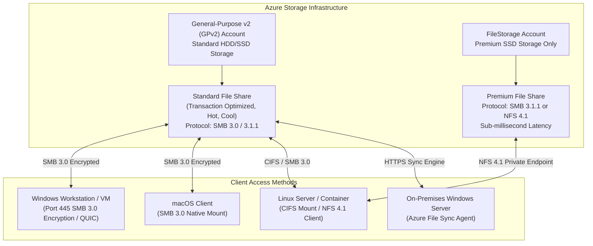

### 1. Protocol Comparison: SMB vs. NFS

| Architectural Dimension | SMB (Server Message Block) | NFS (Network File System) |
| :--- | :--- | :--- |
| **Supported Protocol Versions** | SMB 2.1, SMB 3.0, SMB 3.1.1 | NFS 4.1 |
| **Storage Account Kind** | Standard GPv2 or Premium `FileStorage` | Premium `FileStorage` exclusively |
| **Operating System Support** | Windows, Linux, macOS | Linux exclusively (POSIX compliance) |
| **Encryption in Transit** | SMB 3.x AES-128-GCM / AES-256-GCM (Mandatory) | Transport layer TLS not supported natively; relies on Azure Private Endpoints |
| **Network Routing** | Public endpoint (Port 445) or Private Endpoint | Private Endpoint / VNet only (Public access strictly blocked) |
| **Authentication Mechanisms** | Storage Account Key, Microsoft Entra DS, On-Prem AD DS, Entra Kerberos | POSIX UID/GID mapping (Identity authentication not supported) |
| **File Locking Mechanics** | Opportunistic locks (Oplocks), lease models | Full POSIX byte-range locking |

### 2. Standard vs. Premium Storage Tiers

Azure Files provides four distinct storage tiers categorized across two underlying storage account architectures:

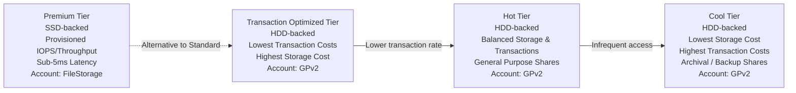

1. **Premium Tier**:
   - Provisioned exclusively on SSD media within dedicated `FileStorage` accounts.
   - Employs a **provisioned model**: you pay for allocated capacity, IOPS, and throughput regardless of consumption.
   - Ideal for high-I/O workloads: database files, enterprise ERP shares, high-performance web servers, and container root volumes.
2. **Transaction Optimized Tier**:
   - Provisioned on standard general-purpose v2 (GPv2) storage accounts.
   - Charges the highest storage capacity fee among standard tiers, but the lowest transaction fee per 10,000 operations.
   - Designed for heavy read/write transactional workloads that cannot justify premium SSD costs.
3. **Hot Tier**:
   - Balanced capacity and transaction pricing for standard corporate team shares and general-purpose applications.
4. **Cool Tier**:
   - Optimized for infrequent access and archival workloads. Capacity cost is minimal, but transaction fees (especially reads) are significantly higher.

### 3. The "Port 445 Problem" and Modern Resolution Strategies

The SMB protocol operates over **TCP Port 445**. Historically, many residential and commercial Internet Service Providers (ISPs) block outbound Port 445 at the gateway level due to legacy security vulnerabilities (e.g., NetBIOS exploits, WannaCry). When a client attempts to connect to `<account>.file.core.windows.net` directly from an ISP network with Port 445 blocked, connection timeouts occur.

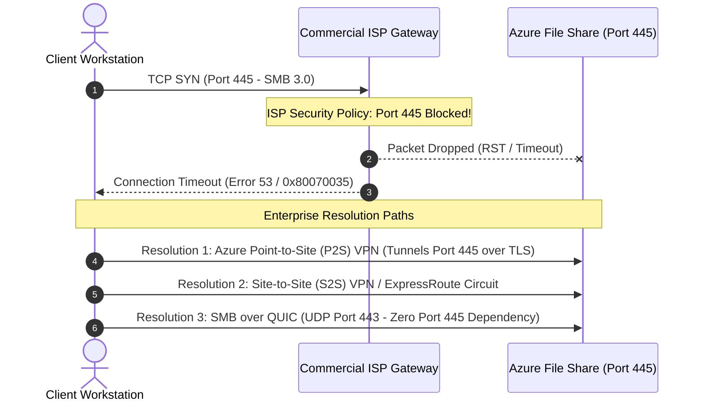

#### Enterprise Solutions:
1. **Azure Point-to-Site (P2S) or Site-to-Site (S2S) VPN**: Tunnels SMB traffic inside an encrypted IPSec/IKEv2 or OpenVPN tunnel directly into the Azure Virtual Network hosting a Private Endpoint for Azure Files.
2. **SMB over QUIC**: Introduced in Windows Server 2022/2025 Datacenter Azure Edition and Windows 11 Enterprise. Replaces the underlying TCP transport with **QUIC (UDP Port 443)** using TLS 1.3 encryption. Because UDP Port 443 (standard HTTPS/QUIC traffic) is universally open on all ISPs and corporate firewalls, clients connect natively without requiring a VPN.

### 4. Identity-Based Authentication vs. Shared Keys

When mounting an Azure File Share, organizations choose between two fundamental authentication models:

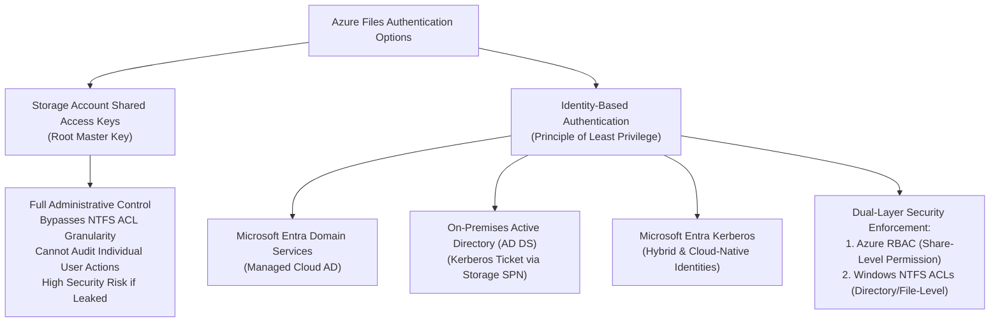

1. **Storage Account Key Authentication**:
   - The user mounts the share using the storage account name as the username and the 512-bit access key as the password.
   - Provides unrestricted superuser access to all files and directories on the share.
   - Incompatible with enterprise environments where granular directory permissions and audit trails are mandatory.
2. **Identity-Based Authentication**:
   - Enforces two discrete permission tiers:
     - **Share-Level Permissions (Azure RBAC)**:
       - `Storage File Data SMB Share Reader`: Read-only access to the share.
       - `Storage File Data SMB Share Contributor`: Read, write, and delete files.
       - `Storage File Data SMB Share Elevated Contributor`: Read, write, delete, and configure Windows NTFS file permissions.
     - **Directory and File-Level Permissions (NTFS ACLs)**: Standard Windows security descriptors (Read, Modify, Full Control) managed via File Explorer or `icacls`.

---

## Part 2: Step-by-Step Hands-On Implementation: Azure File Share Creation, Mounting, Snapshots, and Soft Delete

### Phase 1: Provisioning the Classic File Share

1. Navigate to the Azure Portal, open the storage account `azurestudystorage01`, and under **Data storage**, select **Classic file shares**.
2. Click **+ Classic file share** to open the creation wizard.

<div style="text-align: center; margin: 1.5rem 0;">
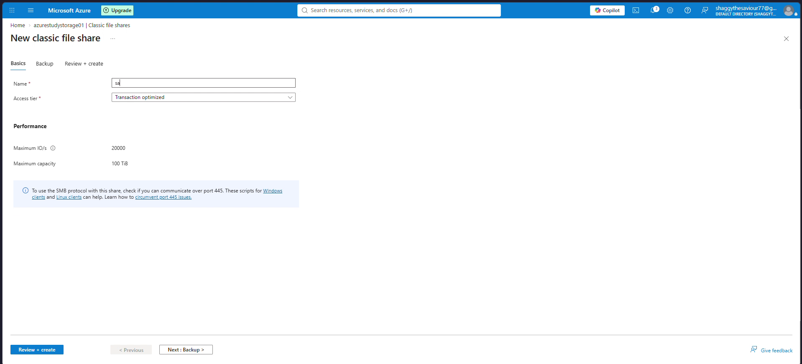
<p style="font-size: 0.85rem; color: #666; margin-top: 0.5rem;">Figure 1: New classic file share wizard displaying share name salesdeptdocuments, Transaction optimized access tier, and maximum capacity of 100 TiB.</p>
</div>

3. Configure the file share settings:
   - **Name**: `salesdeptdocuments`
   - **Access tier**: `Transaction optimized`
   - **Performance**: Standard (Maximum IO/s: 20,000, Maximum capacity: 100 TiB)
4. Notice the informational notification regarding SMB port connectivity:
   > *"To use the SMB protocol with this share, check if you can communicate over port 445. These scripts for Windows clients and Linux clients can help."*
5. Click **Review + create**, and complete the provisioning.

---

### Phase 2: Generating the Windows Connection Script

1. Open the newly provisioned `salesdeptdocuments` file share blade.
2. In the top action bar, click **Connect**.
3. In the **Connect** flyout on the right:
   - Select the **Windows** operating system tab.
   - Select the target drive letter: **`Z`**.
   - Select the authentication method: **Storage account key**.

<div style="text-align: center; margin: 1.5rem 0;">
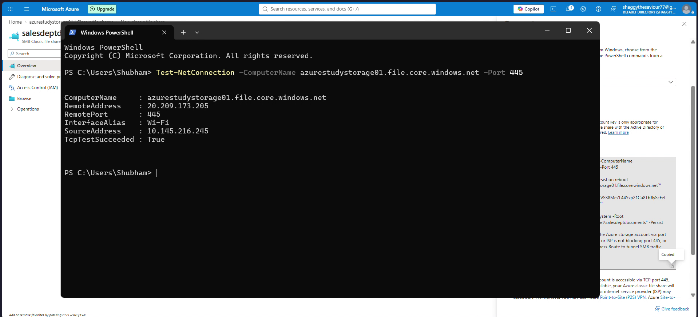
<p style="font-size: 0.85rem; color: #666; margin-top: 0.5rem;">Figure 2: Connect flyout generating the automated PowerShell mounting script with SMB port 445 pre-flight checks and credential storage.</p>
</div>

4. Review the generated PowerShell code:
   - **Port 445 Probe**: Executes `Test-NetConnection -ComputerName azurestudystorage01.file.core.windows.net -Port 445` to verify network reachability before attempting a mount.
   - **Credential Persistence**: Executes `cmdkey.exe /add:"azurestudystorage01.file.core.windows.net" /user:"localhost\azurestudystorage01" /pass:"..."` to register the credentials in Windows Credential Manager so the drive automatically reconnects upon reboot.
   - **Drive Mounting**: Executes `New-PSDrive -Name Z -PSProvider FileSystem -Root "\\azurestudystorage01.file.core.windows.net\salesdeptdocuments" -Persist`.

---

### Phase 3: Executing the Mount Script on the Local Workstation

1. Open a local Windows PowerShell terminal.
2. Paste and execute the Azure-generated mounting script.

<div style="text-align: center; margin: 1.5rem 0;">
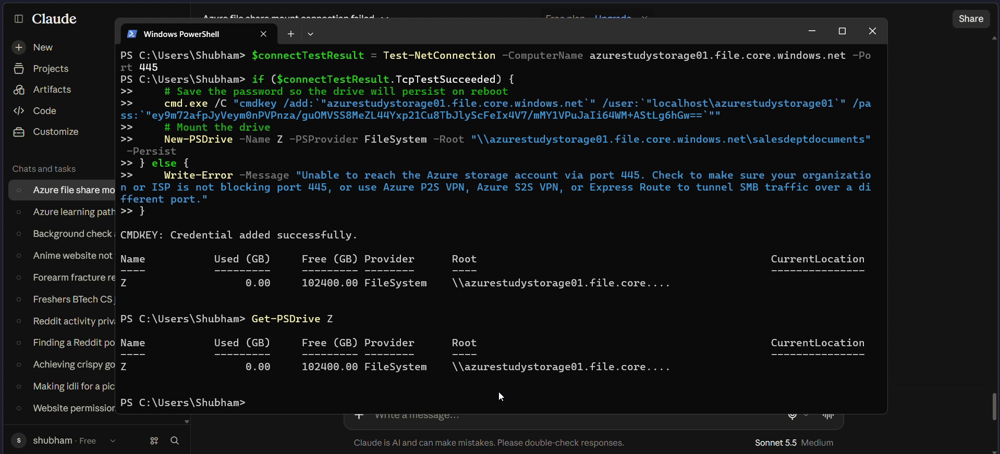
<p style="font-size: 0.85rem; color: #666; margin-top: 0.5rem;">Figure 3: Executing the mount script in Windows PowerShell, confirming credential addition via CMDKEY and drive mapping to Z:.</p>
</div>

3. The command outputs:
   - `CMDKEY: Credential added successfully.`
   - Drive `Z` mapped with `Used (GB): 0.00` and `Free (GB): 102400.00` (100 TiB allocated ceiling).
4. Verify the active drive mount by executing `Get-PSDrive Z`:

<div style="text-align: center; margin: 1.5rem 0;">
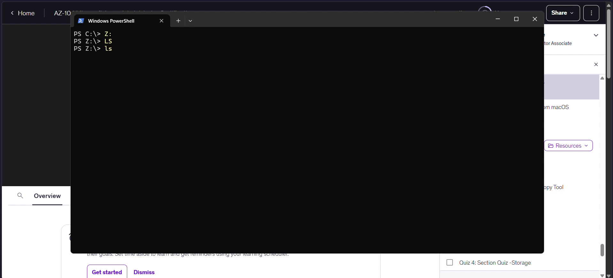
<p style="font-size: 0.85rem; color: #666; margin-top: 0.5rem;">Figure 4: PowerShell Get-PSDrive Z verification confirming the active network file system mount pointing to the Azure storage endpoint.</p>
</div>

---

### Phase 4: Local File System Operations and Data Population

1. Switch into the mounted drive letter:
   ```powershell
   Z:
   ls
   ```
2. Create a new directory named `Sales2026`:
   ```powershell
   New-Item -Path "Z:\Sales2026" -ItemType Directory
   ```
3. Copy an enterprise document (`expenses_aug_sep_2026.pdf`) from the local workstation into the remote Azure File Share:
   ```powershell
   Copy-Item "C:\Users\Shubham\Desktop\expenses_aug_sep_2026.pdf" -Destination "Z:\Sales2026\"
   ```

<div style="text-align: center; margin: 1.5rem 0;">
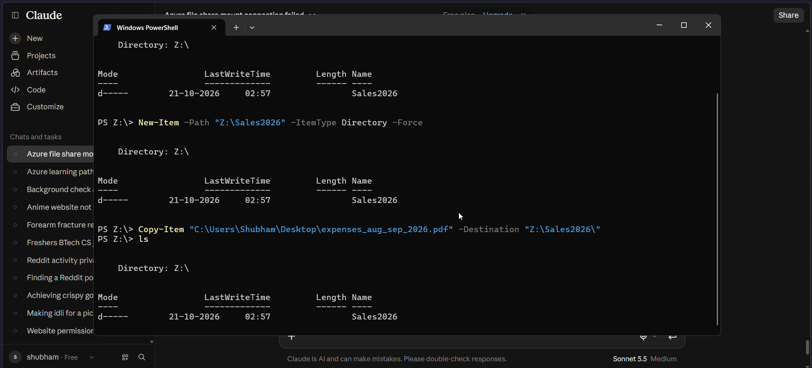
<p style="font-size: 0.85rem; color: #666; margin-top: 0.5rem;">Figure 5: Navigating to Z:, creating directory Sales2026, and copying expenses_aug_sep_2026.pdf into the Azure File Share.</p>
</div>

---

### Phase 5: Verifying Remote Sync in the Azure Portal

1. Return to the Azure Portal and open `azurestudystorage01 | Classic file shares`.

<div style="text-align: center; margin: 1.5rem 0;">
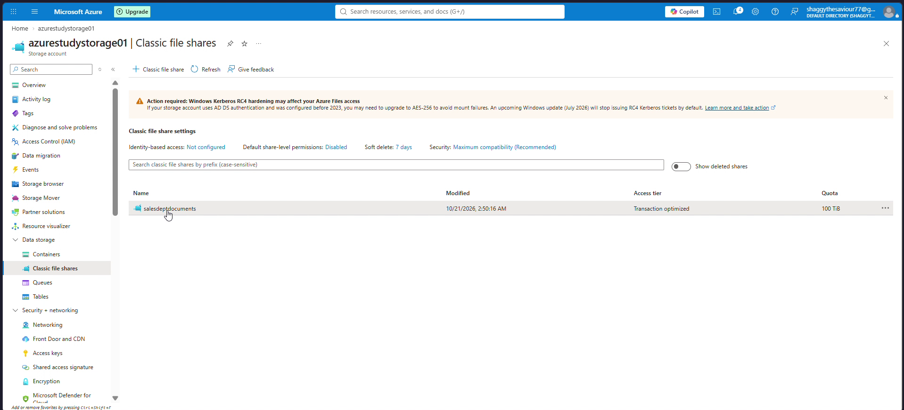
<p style="font-size: 0.85rem; color: #666; margin-top: 0.5rem;">Figure 6: Classic file shares blade displaying salesdeptdocuments with Transaction optimized tier and 100 TiB quota.</p>
</div>

2. Click on `salesdeptdocuments` and open the directory `Sales2026`.

<div style="text-align: center; margin: 1.5rem 0;">
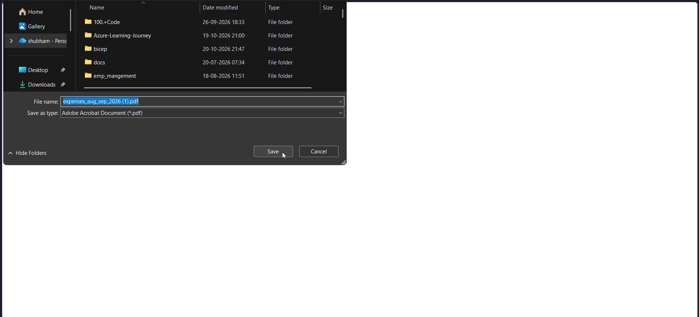
<p style="font-size: 0.85rem; color: #666; margin-top: 0.5rem;">Figure 7: Inspecting the synced file expenses_aug_sep_2026.pdf (6.15 KiB) inside directory Sales2026 via the Azure Portal.</p>
</div>

3. The file `expenses_aug_sep_2026.pdf` (6.15 KiB) is immediately visible, proving bidirectional synchronization between the local Windows SMB mount and the cloud file storage plane.

---

### Phase 6: Orchestrating File Share Snapshots and Simulating Data Loss

1. In the storage account overview, review the general **Data protection** posture.

<div style="text-align: center; margin: 1.5rem 0;">
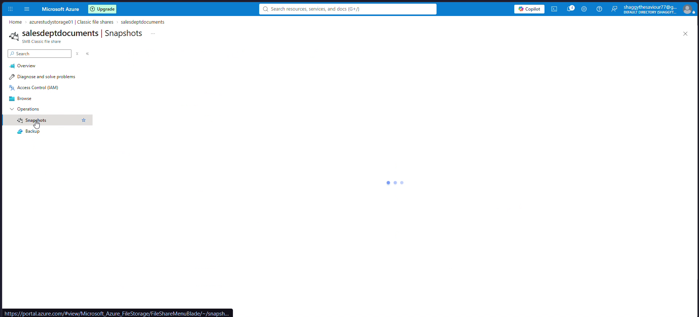
<p style="font-size: 0.85rem; color: #666; margin-top: 0.5rem;">Figure 8: Storage account Data protection blade reviewing soft delete configuration for blobs and containers.</p>
</div>

2. Navigate back to the `salesdeptdocuments` file share blade.
3. Under **Operations**, select **Snapshots**.
4. Click **+ Add snapshot**, enter the comment `quarterlysnapshot`, and click **OK**.

<div style="text-align: center; margin: 1.5rem 0;">
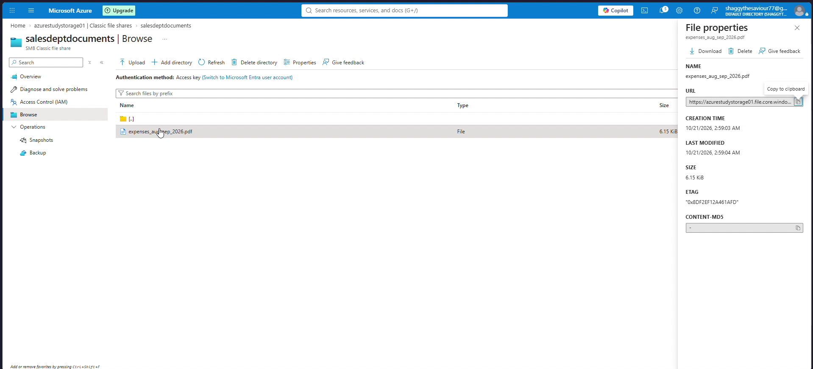
<p style="font-size: 0.85rem; color: #666; margin-top: 0.5rem;">Figure 9: Manual point-in-time snapshot 2026-10-20T21:31:17.0000000Z created with comment quarterlysnapshot.</p>
</div>

5. **Simulate Data Loss**:
   - Navigate to `Browse > Sales2026`.
   - Select `expenses_aug_sep_2026.pdf` and click **Delete**.
   - The Azure Portal displays the confirmation notification:
     > *"Successfully deleted file 'salesdeptdocuments/Sales2026/expenses_aug_sep_2026.pdf'"*

<div style="text-align: center; margin: 1.5rem 0;">
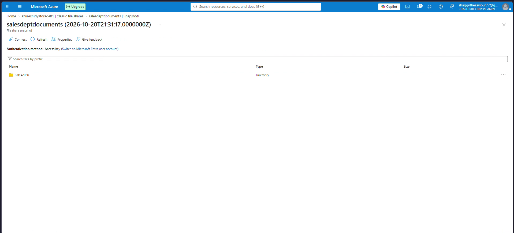
<p style="font-size: 0.85rem; color: #666; margin-top: 0.5rem;">Figure 10: Confirmation of accidental file deletion triggering data recovery procedures.</p>
</div>

---

### Phase 7: Granular File Restoration from Snapshot

1. Under **Operations**, select **Snapshots**, and click the snapshot timestamp `2026-10-20T21:31:17.0000000Z`.
2. Browse inside directory `Sales2026` within the snapshot view.
3. Notice that `expenses_aug_sep_2026.pdf` exists intact in the read-only snapshot.
4. Select the file and click **Restore** in the right-hand **File properties** pane.

<div style="text-align: center; margin: 1.5rem 0;">
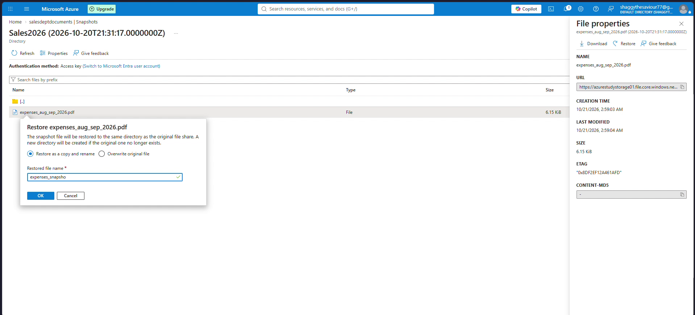
<p style="font-size: 0.85rem; color: #666; margin-top: 0.5rem;">Figure 11: File restoration dialog offering options to overwrite the original file or restore as a renamed copy (expenses_snap).</p>
</div>

5. The restore dialog offers two strategies:
   - **Overwrite original file**: Replaces the active file with the snapshot copy.
   - **Restore as a copy and rename**: Preserves existing files and recovers the asset under a new name (e.g., `expenses_snap`).
6. Select **Restore as a copy and rename**, enter `expenses_snap`, and click **OK**.
7. The file is recovered instantly into `salesdeptdocuments/Sales2026/` without service interruption.

---

### Phase 8: Hardening File Share Soft Delete Retention

While snapshots protect against file modifications and accidental item deletions, they do not protect the file share itself from being deleted. If an administrator deletes the entire file share, all snapshots are deleted simultaneously.

**File Share Soft Delete** provides safety against accidental share-level deletion:

1. Return to `azurestudystorage01 | Classic file shares`.
2. Click on **Soft delete: 7 days** in the settings header.
3. Update the retention period from `7` days to **`20`** days.
4. Click **Save**.

<div style="text-align: center; margin: 1.5rem 0;">
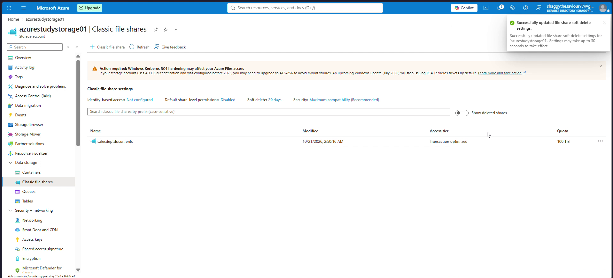
<p style="font-size: 0.85rem; color: #666; margin-top: 0.5rem;">Figure 12: Notification confirming successful update of file share soft delete retention settings to 20 days.</p>
</div>

5. A toast notification confirms:
   > *"Successfully updated file share soft delete settings for 'azurestudystorage01'. Settings may take up to 30 seconds to take effect."*
6. If the file share is deleted, it transitions into a soft-deleted state for 20 days, during which an administrator can click **Show deleted shares** and issue an instant **Undelete** command.

---

## Part 3: Deep Dive: Enterprise Data Transfer and Migration with AzCopy (v10)

While graphical tools like Azure Portal and Storage Explorer are useful for administrative tasks, enterprise production environments demand automated, scriptable, and resilient tooling for moving terabytes of data. **AzCopy v10** is Microsoft's dedicated high-performance CLI utility for copying data to, from, and between Azure Storage accounts.

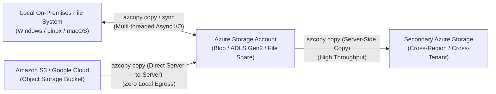

### 1. AzCopy Architecture and Concurrency Mechanics

AzCopy v10 is built from scratch in Go. It differs fundamentally from generic copy tools (like `robocopy` or `rsync`):
- **Asynchronous Parallelism**: AzCopy bypasses single-threaded bottlenecks by decomposing files into parallel block ranges and streaming them concurrently over multiple HTTP/REST connections.
- **Auto-Tuning Engine**: By default, AzCopy detects host CPU cores and network adapter saturation to scale the internal worker pool dynamically.
- **Manual Concurrency Override**: In high-bandwidth environments (10 Gbps+ ExpressRoute or Azure VM-to-VM transfers), administrators can override worker scaling using the `AZCOPY_CONCURRENCY_VALUE` environment variable:
  ```powershell
  # Configure AzCopy to allocate up to 1,000 concurrent worker routines
  $env:AZCOPY_CONCURRENCY_VALUE = "1000"
  ```
  *(Default maximum is 300,000 workers).*

### 2. Authentication Models: OAuth 2.0 vs. SAS Tokens

AzCopy supports two primary authentication paradigms:

| Authentication Method | Target Supported | Command Example | Optimal Use Case |
| :--- | :--- | :--- | :--- |
| **Microsoft Entra ID (OAuth)** | Blob Storage & ADLS Gen2 | `azcopy login`<br>`azcopy copy "data/" "https://<account>.blob.core.windows.net/container" --recursive` | Enterprise scripts with zero hardcoded credentials; leverages Entra ID RBAC |
| **Shared Access Signature (SAS)** | Blob Storage, ADLS Gen2, and **Azure Files** | `azcopy copy "data/" "https://<account>.file.core.windows.net/share?<sas_token>" --recursive` | **Mandatory for Azure Files** (Entra ID OAuth is not supported for File Share transfers via AzCopy) |

> [!IMPORTANT]
> AzCopy does **not** support Microsoft Entra ID authentication (`azcopy login`) when copying into or out of **Azure Files**. You **must** authenticate to Azure File Shares using a Shared Access Signature (SAS) token appended to the file share URI.

### 3. AzCopy Core Operations: Copy vs. Sync

Understanding the difference between `copy` and `sync` is a major exam objective and operational requirement:

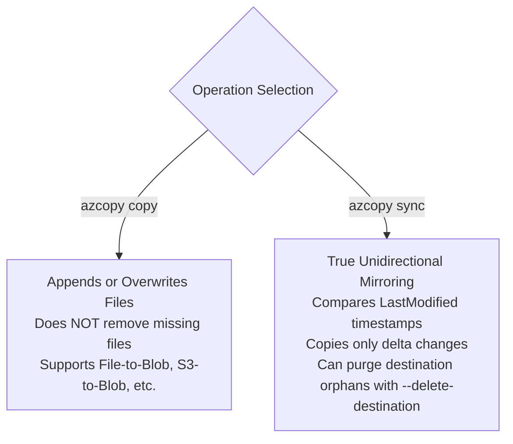

#### A. Copying Files and Recursive Directories (`azcopy copy`)

To copy an entire directory from a local server to an Azure File Share:
```powershell
azcopy copy "C:\CorporateData\Reports\*" `
  "https://azurestudystorage01.file.core.windows.net/salesdeptdocuments/Reports?sv=2024-11-04&ss=f&srt=sco&sp=rwlc&se=2026-10-22T00:00:00Z&sig=..." `
  --recursive=true
```

To copy specific file patterns (e.g., only PDF documents):
```powershell
azcopy copy "C:\CorporateData\Reports\*" `
  "https://azurestudystorage01.file.core.windows.net/salesdeptdocuments/Reports?<SAS>" `
  --include-pattern "*.pdf" `
  --recursive=true
```

#### B. Synchronizing Delta Changes (`azcopy sync`)

The `sync` command compares source and destination files based on file names and last modified timestamps, transferring **only** files that have been modified or added:
```powershell
azcopy sync "C:\CorporateData\Reports" `
  "https://azurestudystorage01.file.core.windows.net/salesdeptdocuments/Reports?<SAS>" `
  --recursive=true `
  --delete-destination=prompt
```

Flags for `--delete-destination`:
- `false` (default): Files deleted from the local source are kept on the Azure File Share.
- `true`: Files deleted from the source are deleted immediately from the destination file share without asking.
- `prompt`: Asks the operator for interactive confirmation before purging each orphaned file.

### 4. Server-Side Direct Cloud Migration (AWS S3 to Azure)

AzCopy can ingest data directly from Amazon Web Services (AWS) S3 buckets into Azure Blob or File storage. This transfer executes entirely across cloud backbone networks:
- Data streams directly from AWS S3 endpoints into Azure Storage infrastructure.
- Zero data traverses the local workstation or on-premises internet link (saving local bandwidth and hours of transit time).

```powershell
# Set AWS access credentials as environment variables
$env:AWS_ACCESS_KEY_ID = "AKIAEXAMPLEKEY"
$env:AWS_SECRET_ACCESS_KEY = "wJalrXUtnFEMI/K7MDENG/bPxRfiCYEXAMPLEKEY"

# Execute direct server-side cloud migration
azcopy copy "https://s3.us-east-1.amazonaws.com/my-enterprise-s3-bucket/*" `
  "https://azurestudystorage01.blob.core.windows.net/s3migration?<SAS>" `
  --recursive=true
```

### 5. Resilient Job Management and Resume Operations

Every AzCopy execution creates a discrete **Job** identified by a unique GUID. AzCopy stores job state and binary journal files (`.plan` files) in `%USERPROFILE%\.azcopy` on Windows or `~/.azcopy` on Linux.

If a multi-terabyte transfer is interrupted by a network disconnect, machine reboot, or transient error:
1. List recent jobs to locate the interrupted Job ID:
   ```powershell
   azcopy jobs list
   ```
2. Inspect the failure summary:
   ```powershell
   azcopy jobs show 84b2e811-64d8-4cb9-b684-29d93bbcf1e2
   ```
3. Resume the transfer precisely from where it stalled without re-uploading completed blocks:
   ```powershell
   azcopy jobs resume 84b2e811-64d8-4cb9-b684-29d93bbcf1e2 --destination-sas="?<New_SAS_if_expired>"
   ```

---

## Part 4: Azure Tooling Matrix: When to Use What

| Tool / Technology | Primary Protocol | Data Scale | Key Differentiator | Typical Use Case |
| :--- | :--- | :--- | :--- | :--- |
| **Azure Files** | SMB 3.x / NFS 4.1 | Up to 100 TiB per share | Native OS file system mount (`Z:`, `/mnt/share`), concurrent file locks | Legacy app lift-and-shift, central department shares, container stateful volumes |
| **Azure File Sync** | HTTPS (Sync Engine) + Local SMB | Up to 100 TiB | Caches hot data locally on Windows Server while archiving cold data to Azure | Branch office file server consolidation with sub-second local LAN latency |
| **AzCopy v10** | REST API (HTTP/HTTPS) | Hundreds of GBs to multi-TB | Ultra-fast parallel CLI tool, scriptable, job-resumable, cross-cloud (S3/GCP) | Scheduled backup pipelines, large initial data migrations, DevOps automation |
| **Azure Storage Explorer** | REST API (HTTP/HTTPS) | Ad-hoc files / folders | Graphical desktop GUI (powered under the hood by AzCopy) | Developer exploration, viewing blob properties, generating SAS tokens |
| **Azure Data Box Family** | Physical Appliance (NFS/CIFS) | 40 TB to Petabytes | Offline physical transfer appliance shipped via UPS/FedEx | Migrations over 40 TB where local internet upload speeds would take months |

---

## Part 5: High-Yield AZ-104 Exam Traps & Distractor Alerts

> [!WARNING]
> **Exam Trap 1: Attempting to Mount NFS Azure File Shares Over the Public Internet**
> In AZ-104 questions, a scenario will ask how to connect Linux clients over the public internet to an NFS Azure File Share. 
> *The trap*: NFS 4.1 in Azure does **not** support public endpoints or public internet transit. NFS file shares require a **Private Endpoint** within an Azure VNet. Any answer suggesting public access over port 2049 is an incorrect distractor!

> [!WARNING]
> **Exam Trap 2: AzCopy Authentication Restrictions for Azure Files**
> The question describes an automated script using AzCopy to upload documents into an Azure File Share and asks which authentication method to choose.
> *The trap*: Selecting Microsoft Entra ID (`azcopy login`). While Entra ID is supported for Blob and ADLS Gen2, AzCopy **strictly requires a SAS token** to authenticate against Azure File Shares.

> [!WARNING]
> **Exam Trap 3: Share-Level RBAC vs. NTFS ACL Permission Precedence**
> When configuring identity-based authentication for Azure Files, an administrator assigns the `Storage File Data SMB Share Reader` role to a user. Inside Windows File Explorer, the administrator assigns the user `Full Control` in the NTFS Security tab. Can the user delete files?
> *The reality*: **No.** Azure evaluates permissions using the **most restrictive intersection**. Because the share-level RBAC role is Reader (Read-only), the user cannot write or delete files regardless of how permissive the NTFS ACL is.

> [!WARNING]
> **Exam Trap 4: File Share Soft Delete vs. Snapshot Scope**
> A user accidentally deletes an individual file from a share. Can they restore the file using File Share Soft Delete?
> *The reality*: **No.** File Share Soft Delete protects the **entire share** from being deleted. It does not restore individual files. Individual files must be restored from **File Share Snapshots** or backups. Conversely, deleting a file share deletes all its snapshots; recovering the share via Soft Delete restores both the share and its snapshot history.

---

## Part 6: Production Automation Reference

### 1. Azure CLI: Provisioning File Shares and Quotas

```bash
# Define environment variables
RESOURCE_GROUP="azure-study"
STORAGE_ACCOUNT="azurestudystorage01"
SHARE_NAME="corporateshare01"

# Provision a new standard file share in the Hot access tier with a 500 GiB quota
az storage share-rm create \
  --resource-group $RESOURCE_GROUP \
  --storage-account $STORAGE_ACCOUNT \
  --name $SHARE_NAME \
  --access-tier "Hot" \
  --quota 500 \
  --enabled-protocols "SMB"

# Create a point-in-time snapshot with metadata
az storage share snapshot \
  --account-name $STORAGE_ACCOUNT \
  --name $SHARE_NAME \
  --metadata "environment=production" "creator=automated_backup" \
  --auth-mode key

# Update file share soft delete retention to 30 days
az storage account file-service-properties update \
  --resource-group $RESOURCE_GROUP \
  --account-name $STORAGE_ACCOUNT \
  --enable-delete-retention true \
  --delete-retention-days 30
```

### 2. PowerShell: Automated AzCopy Batch Ingestion Script

```powershell
<#
.SYNOPSIS
  Automated script to synchronize local directory with an Azure File Share using AzCopy v10.
#>

$StorageAccount = "azurestudystorage01"
$ShareName = "salesdeptdocuments"
$SourcePath = "D:\CorporateData\Sales"
$AzCopyPath = "C:\Tools\azcopy.exe"

# Generate short-lived SAS token for the file share using Azure CLI / PowerShell
$SasExpiry = (Get-Date).AddHours(4).ToString("yyyy-MM-ddTHH:mm:ssZ")
$SasToken = az storage share generate-sas `
  --account-name $StorageAccount `
  --name $ShareName `
  --permissions "rwlc" `
  --expiry $SasExpiry `
  --output tsv

$DestinationUri = "https://$StorageAccount.file.core.windows.net/$ShareName/Sales?$SasToken"

# Configure high-performance concurrency
$env:AZCOPY_CONCURRENCY_VALUE = "512"

# Execute delta sync without deleting destination files
& $AzCopyPath sync $SourcePath $DestinationUri --recursive=true --delete-destination=false

Write-Host "Synchronization completed successfully."
```

---

## Summary of Day 15 Achievements

1. **Architectural Mastery**: Analyzed SMB 3.0/3.1.1 vs NFS 4.1 protocols, storage tiers (Premium, Transaction Optimized, Hot, Cool), and circumvention strategies for the ISP Port 445 block.
2. **Hands-On File Share Deployment**: Provisioned `salesdeptdocuments` with a 100 TiB quota in `azurestudystorage01`.
3. **Automated Windows Mounting**: Executed PowerShell SMB connectivity probes, registered persistent credentials via `cmdkey`, and mounted drive `Z:`.
4. **Local and Cloud Data Validation**: Created folder hierarchies, uploaded enterprise assets locally, and verified instant portal synchronization.
5. **Data Protection & Disaster Recovery**: Provisioned manual snapshot `quarterlysnapshot`, simulated accidental file deletion, and executed non-destructive restoration (`expenses_snap`).
6. **Soft Delete Hardening**: Extended file share soft delete retention to 20 days.
7. **AzCopy v10 Deep Dive**: Deconstructed Go-based asynchronous concurrency, OAuth vs. SAS authentication constraints, `copy` vs `sync` mechanics, and direct AWS S3 cross-cloud migration workflows.
